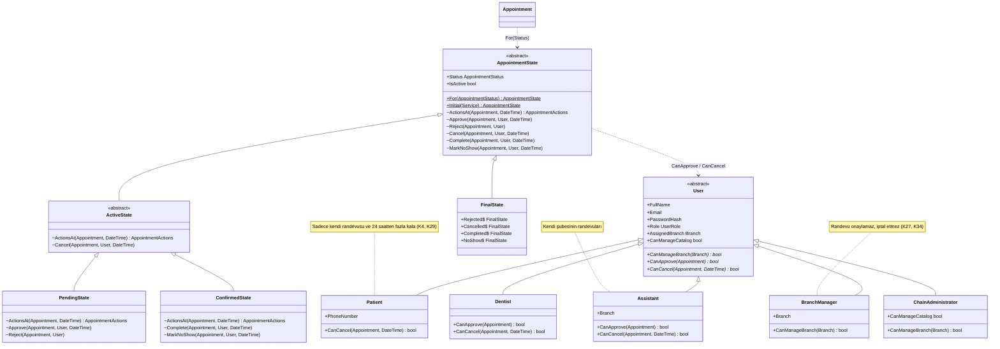
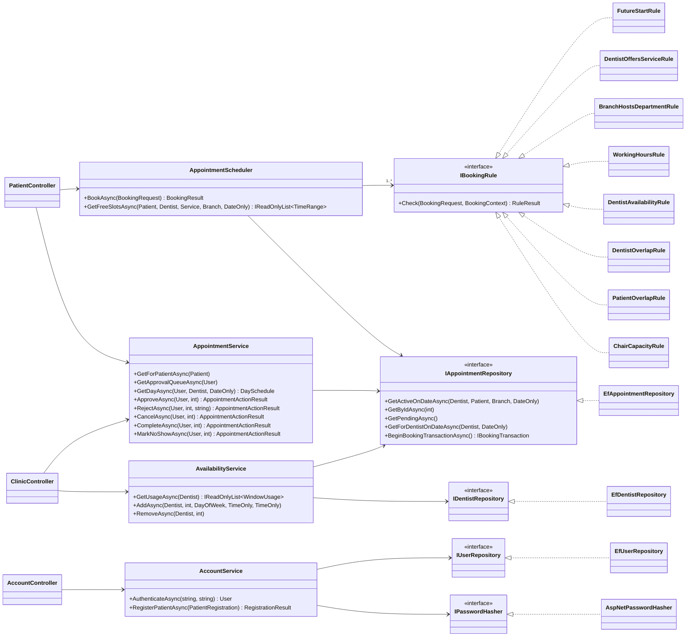
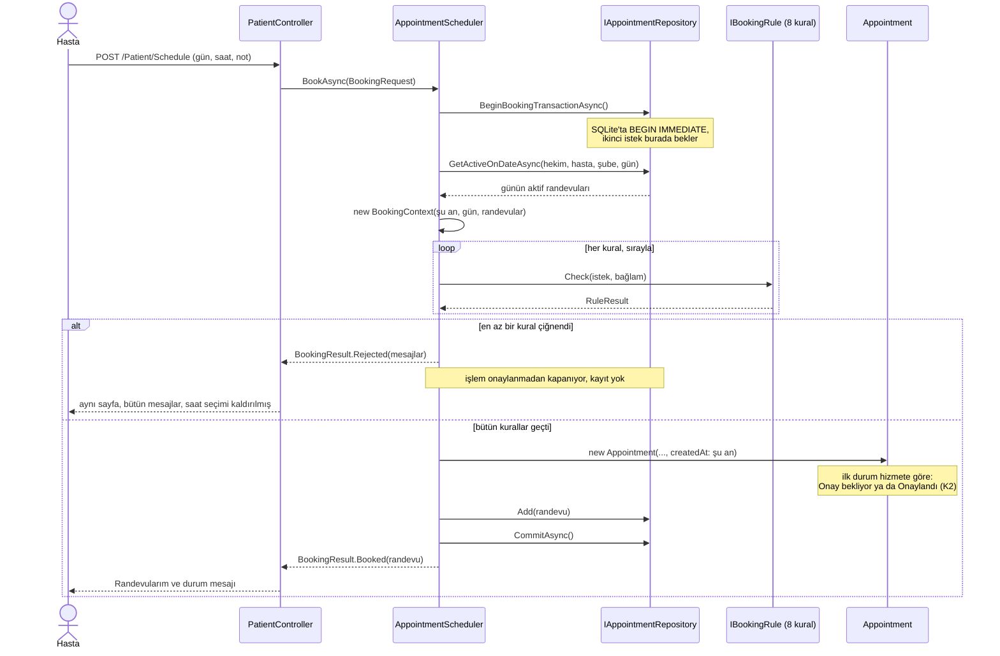
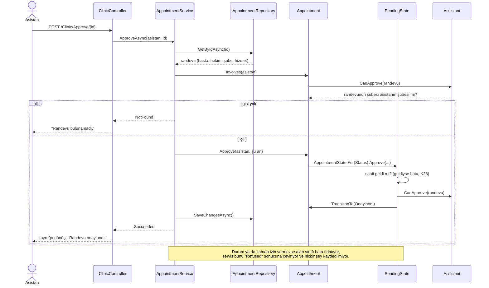

# Diş Kliniği Randevu Sistemi

**GitHub deposu:** https://github.com/ertugrulkoksal-sau/dis-klinigi-randevu-sistemi

> **Commit geçmişi GitHub'da.** SABİS'e yüklenen .zip dosyasında `.git` klasörü yok; günlük
> commit'ler ve Pull Request'ler (6–15 Kasım) yukarıdaki depoda görülebilir:
> [commit geçmişi](https://github.com/ertugrulkoksal-sau/dis-klinigi-randevu-sistemi/commits/main),
> [Pull Request'ler](https://github.com/ertugrulkoksal-sau/dis-klinigi-randevu-sistemi/pulls?q=is%3Apr).

BSM515 Nesneye Dayalı Programlama dersi bireysel projesi (Seçenek A: Hastane/Klinik
Randevu Sistemi). Ödevi çok şubeli bir diş kliniği zincirine uyarladım: hastalar şube,
bölüm, hizmet ve hekim seçerek randevu alıyor; sistem hekim, hasta ve şubedeki diş
koltuğu (ünit) çakışmalarını kontrol ediyor; tedavi randevuları hekim ya da asistan
onayından geçiyor.

> Proje geliştirme aşamasında. Günlük ilerleme için [docs/gunluk-plan.md](docs/gunluk-plan.md),
> alan modeli ve tasarım kararları için [docs/tasarim.md](docs/tasarim.md), ekran tasarımları
> için [docs/arayuz-tasarimi.md](docs/arayuz-tasarimi.md).

## Teknolojiler

- ASP.NET Core MVC, .NET 10 (LTS)
- Entity Framework Core 10 + SQLite (dosya veritabanı, ayrı sunucu gerekmiyor)
- xUnit (birim testleri)

Windows'a özgü hiçbir bileşen kullanılmıyor; proje macOS, Linux ve Windows'ta aynı şekilde çalışıyor.

## Kurulum ve çalıştırma

Gereken tek şey **.NET 10 SDK**. Veritabanı (SQLite) bir dosya olarak proje içinde
oluşturulduğu için ayrı bir veritabanı sunucusu kurmaya gerek yok.

### macOS (sunum bu adımlarla yapılıyor)

**1. .NET 10 SDK'yı kurun** (bir kez yapılır). İki yoldan biri yeterli:

- [dotnet.microsoft.com/download/dotnet/10.0](https://dotnet.microsoft.com/download/dotnet/10.0)
  adresinden macOS **Installer** paketini indirip kurun. Apple Silicon (M1/M2/M3/M4) için
  **Arm64**, Intel Mac için **x64** sürümünü seçin.
- Homebrew kullanıyorsanız:

  ```bash
  brew install --cask dotnet-sdk
  ```

Kurulumdan sonra **yeni bir Terminal penceresi** açıp kontrol edin; listede `10.0.` ile
başlayan bir sürüm görünmeli:

```bash
dotnet --list-sdks
```

**2. Projeyi alın.** GitHub'dan:

```bash
git clone https://github.com/ertugrulkoksal-sau/dis-klinigi-randevu-sistemi.git
cd dis-klinigi-randevu-sistemi
```

Ya da teslim edilen .zip'i açıp Terminal'de o klasöre geçin
(`cd ~/Downloads/dis-klinigi-randevu-sistemi` gibi).

**3. Uygulamayı çalıştırın:**

```bash
dotnet run --project src/DisKlinigi.Web
```

İlk çalıştırmada paketler indirildiği için bir dakika kadar sürebilir. Terminal'de
`Now listening on: http://localhost:5080` satırı görününce tarayıcıda
**http://localhost:5080** adresini açın. Durdurmak için Terminal'de `Ctrl + C`.

**4. Testleri çalıştırın:**

```bash
dotnet test
```

#### macOS'te karşılaşılabilecek durumlar

| Durum | Çözüm |
|---|---|
| `dotnet: command not found` | Kurulumdan sonra Terminal'i kapatıp yeniden açın. Hâlâ yoksa: `export PATH="$PATH:/usr/local/share/dotnet"` |
| `address already in use` (5080 portu dolu) | Başka bir port verin: `dotnet run --project src/DisKlinigi.Web --urls http://localhost:5090` |
| Örnek veriye sıfırdan dönmek | Uygulamayı durdurup `rm src/DisKlinigi.Web/dis-klinigi.db*` çalıştırın, sonra tekrar `dotnet run`. |
| https sertifikası uyarısı | Görülmemesi gerekir; uygulama bilerek sadece http ile açılıyor (tasarım kararı K21). |

### Windows / Linux

Aynı komutlar geçerli: `dotnet run --project src/DisKlinigi.Web` ve `dotnet test`.

### İlk çalıştırmada ne oluyor?

`src/DisKlinigi.Web/dis-klinigi.db` adında bir SQLite dosyası oluşturuluyor, şema
migration'larla kuruluyor ve örnek veri otomatik yükleniyor. Sonraki çalıştırmalarda
mevcut veri korunuyor.

Örnek veride 3 şube (Serdivan, Adapazarı Merkez, Kadıköy), 8 bölüm, 10 hizmet, 8 hekim, her
şubede bir asistan ve bir şube yöneticisi, bir zincir yöneticisi ve 8 hasta var. Randevular
veritabanının oluşturulduğu güne göre yerleşiyor: iki hafta öncesinden iki hafta sonrasına kadar,
bugün dahil, her durumdan (onay bekliyor, onaylandı, reddedildi, iptal edildi, tamamlandı, gelmedi)
randevu oluyor (tasarım kararı K39). Sunumdan önce veritabanını silip yeniden oluşturmak,
randevuların sunum gününe göre dizilmesini sağlıyor.

> 10 Kasım'dan önce oluşmuş bir veritabanında sadece üç şube vardı. Yeni örnek veri için
> uygulamayı durdurup veritabanı dosyasını silin (aşağıdaki tabloda "Örnek veriye sıfırdan dönmek").

### Örnek hesaplar

Uygulama açılınca giriş sayfası geliyor. Bütün örnek hesapların parolası aynı: **`Demo1234!`**
(veritabanında her biri ayrı tuzla özetlenmiş halde duruyor, düz metin değil). Girişten sonra
herkes kendi rolünün ilk ekranına yönleniyor; menüde sadece o rolün açabildiği ekranlar var.

| Rol | E-posta | Not |
|---|---|---|
| Hasta | `ali.yildiz@ornek.test` | Diğer hastalar: `zeynep.arslan`, `fatma.kilic`, `mert.dogan`, `ece.gunes`, `kerem.bulut`, `ahmet.simsek`, `buse.karaca` (hepsi `@ornek.test`) |
| Hekim | `ayse.kaya@disklinigi.test` | Salı Serdivan + Kadıköy, Perşembe Serdivan, Cuma Kadıköy. Diğer hekimler: `mehmet.demir`, `burak.sen`, `zehra.aksoy`, `emre.yilmaz`, `gizem.polat`, `okan.erdem`, `selim.kurt` |
| Asistan | `elif.sahin@disklinigi.test` | Serdivan. Adapazarı: `hakan.tekin`, Kadıköy: `can.ozturk` |
| Şube yöneticisi | `murat.celik@disklinigi.test` | Serdivan. Adapazarı: `seda.yurt`, Kadıköy: `deniz.koc` |
| Zincir yöneticisi | `selin.aydin@disklinigi.test` | Bütün şubeler |

Personel e-postalarının hepsi `@disklinigi.test`, hastalarınki `@ornek.test` ile bitiyor
(`.test` uzantısı denemeye ayrılmış, gerçek bir adrese e-posta gitmesi mümkün değil).

Hasta hesabı giriş sayfasındaki "Hasta kaydı" formuyla da açılabiliyor. Personel hesapları
klinik tarafından açılıyor (yönetici paneli, 14 Kasım). 13 Kasım itibarıyla hasta ekranları (randevu al,
randevularım) ve personel paneli (takvim, onay kuyruğu, müsaitlik) çalışıyor; yönetici ekranlarında
henüz hangi gün kodlanacakları yazıyor, sayfalar yine sadece yetkili role açılıyor.

Personel panelini denemek için: `ayse.kaya@disklinigi.test` ile girip "Onay kuyruğu"ndan bir randevuyu
onaylayın ya da gerekçe yazıp reddedin; sonra `elif.sahin@disklinigi.test` (Serdivan asistanı) ile girip
aynı randevunun takvimde hangi butonlarla göründüğüne bakın. Asistan sadece kendi şubesinin randevularını görüyor.

### Teslim paketi

```bash
./scripts/teslim-zip.sh
```

Testleri çalıştırıp `teslim/dis-klinigi-randevu-sistemi.zip` dosyasını üretiyor. Pakete
sadece git'teki dosyalar giriyor; `bin`, `obj` ve yerel veritabanı dışarıda kalıyor.

## Proje yapısı

```
src/
  DisKlinigi.Core/     Alan sınıfları, iş kuralları, arayüzler (altyapıdan bağımsız)
  DisKlinigi.Web/      MVC arayüzü, EF Core veri erişimi, örnek veri
tests/
  DisKlinigi.Tests/    Core için birim testleri; Data klasöründe SQLite üzerinde veri katmanı testleri,
                       Web klasöründe uygulamanın kendisi üzerinden giriş, yetki, hasta ve personel ekranı testleri
docs/
  tasarim.md           Alan modeli, iş kuralları, tasarım kararları ve alternatifleri
  arayuz-tasarimi.md   Onaylanan ekran tasarımları, onay durumu ve inceleme notları
  arayuz/              Ekran tasarımlarının görüntüleri (PNG)
  gunluk-plan.md       6–15 Kasım çalışma planı
scripts/
  teslim-zip.sh        SABİS'e yüklenecek .zip'i üretir
```

## Ödev maddelerinin karşılandığı yerler

Tablo proje ilerledikçe dolduruluyor; "Durum" sütunu o maddenin hangi gün tamamlandığını gösteriyor.

| Ödev maddesi | Sistemde karşılığı | Durum |
|---|---|---|
| Tek klinik ve çok şubeli kuruluş desteği | Zincir → şube modeli; tek klinik = tek şubeli zincir (tasarım K7); örnek veride 3 şube, bazı hekimler iki şubede (K39) | İskelet: `Branch` (6 Kas); örnek veri (10 Kas) |
| Klinikler yetki çerçevesinde tanımlanır | Zincir yöneticisi tüm şubeleri, şube yöneticisi sadece kendi şubesini yönetir (K3); `User.CanManageBranch` her rolde ayrı cevaplanıyor | Alan modeli ve testleri (7 Kas); ekran 14 Kas |
| Çalışma saatleri ve bölümler | `Branch.SetWorkingHours` / `IsOpenDuring`, `Branch.AddDepartment`; saatler `TimeOfDayRange` değer nesnesiyle (K22); veritabanında (şube, gün) anahtarlı tablo ve şube–bölüm ara tablosu (K37) | Alan modeli ve testleri (7 Kas); veritabanı ve testleri (10 Kas) |
| Hizmetler süre ve ücretiyle | `Service`: süre (5 dk katı, en fazla 240 dk), ücret, onay gereksinimi (K2, K25) | Alan modeli ve testleri (7 Kas) |
| Doktor ve sağlık personeli kaydı | Soyut `User` sınıfından türeyen `Dentist`, `Assistant` (K14); bütün kullanıcılar tek tabloda (TPH), parolalar `PasswordHasher` ile özetli (K15, K37); personel aynı giriş ekranından giriş yapıyor, asistanın menüsünde bağlı olduğu şube görünüyor (`User.AssignedBranch`, K44); personel paneli: hekim kendi takvimini, asistan şubesindeki hekimlerin takvimini görüyor (K49) | Alan modeli ve testleri (7 Kas); veritabanı (10 Kas); giriş (11 Kas); personel paneli (13 Kas); kayıt ekranı 14 Kas |
| Doktorun uzmanlık alanı ve verdiği hizmetler | `Dentist.Specialty`, `Dentist.OfferService` / `Offers`, çalıştığı şubeler | Alan modeli ve testleri (7 Kas) |
| Müsaitlik aralıkları; randevu sadece bu aralıklara | `Dentist.AddAvailability` (şube saatine sığma, kesişme kontrolü), `Dentist.IsAvailable` (K8, K24); randevuda `DentistAvailabilityRule`, boş saatler de sadece bu aralıklardan üretiliyor (K32); hekim bütün parçalarıyla `IDentistRepository` ile yükleniyor. Hekim aralıklarını "Müsaitlik" ekranından ekleyip siliyor (`AvailabilityService`); ileri tarihte randevusu olan aralık silinemiyor (K52) | Alan modeli (7 Kas); kural ve testleri (9 Kas); veritabanı (10 Kas); ekran, silme kuralı ve testleri (13 Kas) |
| Personel ve hizmet seçerek randevu | Şube → bölüm → hizmet → hekim → gün → saat akışı (`PatientController.Book`, `Schedule`); her seçim sonrakini daraltıyor, hekim listesi `Dentist.CanServe` ile (K47); boş saatler `AppointmentScheduler.GetFreeSlotsAsync` ile kayıttaki kuralların aynısından geçirilerek üretiliyor (K32); kaydederken saat dolmuşsa çiğnenen kuralların hepsi gösteriliyor | Boş saat üretimi ve testleri (9 Kas); ekranlar ve uygulama üzerinden testleri (12 Kas) |
| Çakışma kontrolü | Strategy deseniyle sekiz `IBookingRule` sınıfı (geçmiş saat, hizmet, bölüm, çalışma saati, müsaitlik, hekim/hasta çakışması, ünit kapasitesi) + `AppointmentScheduler` (K12, K31, K33); ünit kapasitesinde en yüksek eş zamanlı randevu sayısı taranıyor; eş zamanlı istekler için kontrol ve kayıt tek işlemde, SQLite'ta `BEGIN IMMEDIATE` (K19) | Kurallar, planlayıcı ve testleri (9 Kas); veritabanı işlemi ve iki bağlantılı eş zamanlılık testleri (10 Kas) |
| Randevu detaylarının kaydı | `Appointment`: hasta, hekim, şube, `TimeRange` ile başlangıç/bitiş; hizmet adı ve ücreti randevu anındaki haliyle kopyalanıyor (K9, K30); hasta notu ve alındığı an (K35); tabloda `Start`/`End` sütunları, durum metin olarak (K37, K38). Randevularım ekranı süre ve ücreti randevudaki kopyadan gösteriyor | Alan modeli ve testleri (8 Kas); veritabanı ve testleri (10 Kas); hasta ekranı (12 Kas) |
| Onay mekanizması | Hizmete göre ilk durum (K2); planlayıcı ile kaydedilen muayene "Onaylandı", tedavi "Onay bekliyor" olarak çıkıyor, hasta bunu randevu alırken özet kartında ve sonrasında mesajda görüyor; State deseniyle Onay bekliyor → Onaylandı / Reddedildi, geçersiz geçiş hata veriyor (K13, K26, K28); onay yetkisi `User.CanApprove` (K27). Onay kuyruğu ve takvimde onay, gerekçeli ret (K51), tamamlandı/gelmedi; butonlar durumun izni ile kişinin yetkisinin kesişimi (`Appointment.ActionsFor`, K50), kuyrukta kimin ne gördüğü yine `CanApprove` ile (K49) | Alan modeli + 30 hücrelik geçiş tablosu testi (8 Kas); otomatik onay planlayıcıda (9 Kas); kuyruk, takvim, buton/işlem tutarlılık testi ve uygulama üzerinden testler (13 Kas) |
| Randevu iptali (hasta için 24 saat kuralı) | `Appointment.Cancel`, `User.CanCancel`; hasta 24 saatten fazla kala, hekim ve asistan her zaman (başlamadan önce) iptal eder (K4, K29); yöneticiler randevuya dokunmuyor (K34). `AppointmentService.CancelAsync` aynı metotla hastanın ve personelin iptalini yapıyor, ilgisiz kullanıcıya randevu "bulunamadı" (K46). Randevularım'da ve takvimde iptal önce onay soruyor, 24 saatten az kalan randevuda hastanın butonu pasif ve nedeni yazıyor | Alan modeli ve sınır testleri (8 Kas); servis, Randevularım ekranı ve testleri (12 Kas); personel iptali takvimde, yöneticilerin yetkisi kaldırıldı (13 Kas) |
| Roller: Hasta, Doktor/Personel, Yönetici | `Patient`, `Dentist`, `Assistant`, `BranchManager`, `ChainAdministrator` (K14); randevu yetkileri her sınıfta ayrı (`CanApprove`, `CanCancel`). Giriş: çerez kimlik doğrulaması, parola `IPasswordHasher` ile doğrulanıyor, hasta kendi kaydını açıyor (`AccountService`, K15, K43). Sayfa erişimi rol politikalarıyla (`Policies`), varsayılan "giriş zorunlu"; kayda bağlı yetki alan sınıflarında (K41); çerez her istekte veritabanıyla karşılaştırılıyor (K42); role göre menü (`MainMenu`) | Sınıflar (7 Kas); randevu yetkileri (8 Kas); giriş, kayıt, rol politikaları ve 5 rol × 9 sayfa erişim testi (11 Kas); personel paneli (13 Kas) |

## UML diyagramları

Diyagramlar 13 Kasım'daki koddan çıkarıldı; sadece anlatmak istediğim şeyi gösteren üyeler yazıldı
(her özellik ve yardımcı metot yok). İlk taslak, kod yazılmadan önceki haliyle
[docs/tasarim.md](docs/tasarim.md) bölüm 5'te duruyor. Bütün alan sınıfları `Entity`'den (Id ve
`IsSameAs`, K23) türüyor; diyagramlarda kalabalık etmesin diye bu ok çizilmedi.

### Sınıf diyagramı 1: alan modeli

Şube, katalog, hekim ve randevu. Zaman aralıkları değiştirilemez değer nesneleri (K22); randevu,
alındığı andaki hizmet adı ve ücretini kendi üzerinde saklıyor (K9).


### Sınıf diyagramı 2: kalıtım ve çok biçimlilik

Kullanıcı hiyerarşisi ve randevu durumları (State deseni). Yetki soruları (`CanApprove`, `CanCancel`,
`CanManageBranch`) her kullanıcı sınıfında kendi kuralıyla cevaplanıyor (K14); hangi işlemin hangi durumda
ve hangi anda yapılabileceği durum sınıflarında (K13, K26). `~` işaretli metotlar `internal`: durum
sadece randevunun kendi metotlarıyla değişebiliyor; altı çizili üyeler statik. Dört son durum davranış olarak
aynı olduğu için tek sınıfın dört örneği (K26). Randevu iki tarafı `ActionsFor`'da birleştiriyor (K50).



### Sınıf diyagramı 3: servisler, kurallar ve repository'ler

Core arayüzleri tanımlıyor, Web gerçekleştiriyor (Dependency Inversion, K17); `Ef…` ve `AspNetPasswordHasher`
Web projesinde. Çakışma kuralları Strategy deseniyle ayrı sınıflar (K12); planlayıcı kuralların listesini
DI ile alıyor ve hangisinin ne yaptığını bilmiyor. Controller'lar kural yazmıyor, servisleri çağırıyor.



### Sıra diyagramı 1: hasta randevu alıyor

Kontrol ve kayıt aynı işlemde, işlem yazma kilidiyle başlıyor (K19). Kurallar ilk hatada durmuyor;
çiğnenen kuralların hepsi birlikte gösteriliyor (tasarim.md bölüm 3).



### Sıra diyagramı 2: asistan bekleyen randevuyu onaylıyor

Servis sadece sırayı kuruyor; "ilgisi var mı", "bu durumda onaylanabilir mi" ve "bu kişi onaylayabilir mi"
sorularını alan sınıfları cevaplıyor (K46, K27, K28).



README'nin son halinde (14 Kasım) SOLID eşleme tablosu ve tasarım kararlarının özeti de yer alacak.
