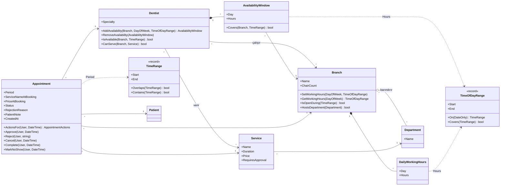
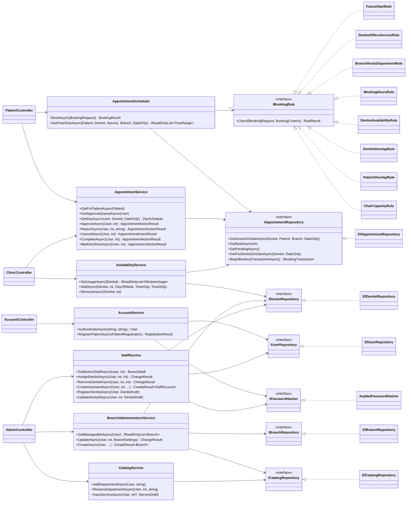
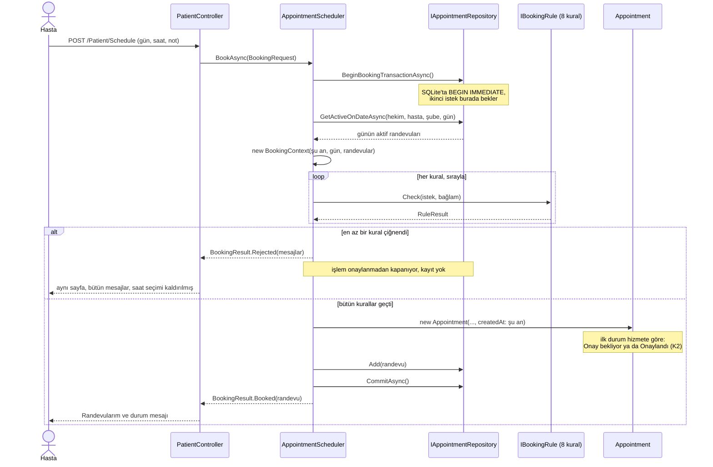
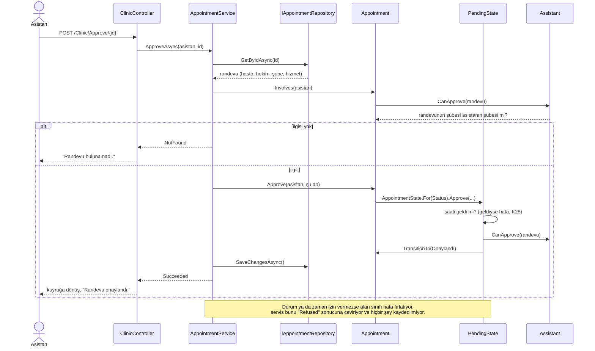
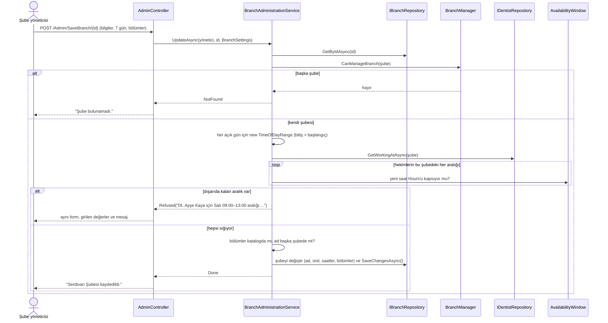

# Diş Kliniği Randevu Sistemi

**GitHub deposu:** https://github.com/ertugrulkoksal-sau/dis-klinigi-randevu-sistemi

> **Commit geçmişi GitHub'da.** SABİS'e yüklenen .zip dosyasında `.git` klasörü yok; günlük
> commit'ler ve Pull Request'ler (6–15 Kasım) yukarıdaki depoda görülebilir:
> [commit geçmişi](https://github.com/ertugrulkoksal-sau/dis-klinigi-randevu-sistemi/commits/main),
> [Pull Request'ler](https://github.com/ertugrulkoksal-sau/dis-klinigi-randevu-sistemi/pulls?q=is%3Apr).

BSM515 Nesneye Dayalı Programlama dersi bireysel projesi (Seçenek A: Hastane/Klinik
Randevu Sistemi). Ödevi çok şubeli bir diş kliniği zincirine uyarladım: hastalar şube,
bölüm, hizmet ve hekim seçerek randevu alıyor; sistem hekim, hasta ve şubedeki diş
koltuğu (ünit) çakışmalarını kontrol ediyor; tedavi randevuları hekim ya da asistan
onayından geçiyor.

Belgeler:

- [docs/tasarim.md](docs/tasarim.md): alan modeli, iş kuralları ve bütün tasarım kararları (K1–K57),
  her biri gerekçesi ve seçmediğim alternatifiyle. Bu README'nin sonunda kısa bir özeti var.
- [docs/arayuz-tasarimi.md](docs/arayuz-tasarimi.md): kod yazılmadan önce hazırlanıp onaylanan ekran
  tasarımları, kodlanma durumu ve tasarımdan bilerek ayrıldığım noktalar.
- [docs/gunluk-plan.md](docs/gunluk-plan.md): 6–15 Kasım çalışma planı.

## Teknolojiler

- ASP.NET Core MVC, .NET 10 (LTS)
- Entity Framework Core 10 + SQLite (dosya veritabanı, ayrı sunucu gerekmiyor)
- xUnit (birim testleri)

Windows'a özgü hiçbir bileşen kullanılmıyor; proje macOS, Linux ve Windows'ta aynı şekilde çalışıyor.

## Kurulum ve çalıştırma

Gereken tek şey **.NET 10 SDK**. Veritabanı (SQLite) bir dosya olarak proje içinde
oluşturulduğu için ayrı bir veritabanı sunucusu kurmaya gerek yok.

### macOS (sunum bu adımlarla yapılıyor)

**1. .NET 10 SDK'yı kurun** (bir kez yapılır). İki yoldan biri yeterli:

- [dotnet.microsoft.com/download/dotnet/10.0](https://dotnet.microsoft.com/download/dotnet/10.0)
  adresinden macOS **Installer** paketini indirip kurun. Apple Silicon (M1/M2/M3/M4) için
  **Arm64**, Intel Mac için **x64** sürümünü seçin.
- Homebrew kullanıyorsanız:

  ```bash
  brew install --cask dotnet-sdk
  ```

Kurulumdan sonra **yeni bir Terminal penceresi** açıp kontrol edin; listede `10.0.` ile
başlayan bir sürüm görünmeli:

```bash
dotnet --list-sdks
```

**2. Projeyi alın.** GitHub'dan:

```bash
git clone https://github.com/ertugrulkoksal-sau/dis-klinigi-randevu-sistemi.git
cd dis-klinigi-randevu-sistemi
```

Ya da teslim edilen .zip'i açıp Terminal'de o klasöre geçin
(`cd ~/Downloads/dis-klinigi-randevu-sistemi` gibi).

**3. Uygulamayı çalıştırın:**

```bash
dotnet run --project src/DisKlinigi.Web
```

İlk çalıştırmada paketler indirildiği için bir dakika kadar sürebilir. Terminal'de
`Now listening on: http://localhost:5080` satırı görününce tarayıcıda
**http://localhost:5080** adresini açın. Durdurmak için Terminal'de `Ctrl + C`.

**4. Testleri çalıştırın:**

```bash
dotnet test
```

#### macOS'te karşılaşılabilecek durumlar

| Durum | Çözüm |
|---|---|
| `dotnet: command not found` | Kurulumdan sonra Terminal'i kapatıp yeniden açın. Hâlâ yoksa: `export PATH="$PATH:/usr/local/share/dotnet"` |
| `address already in use` (5080 portu dolu) | Başka bir port verin: `dotnet run --project src/DisKlinigi.Web --urls http://localhost:5090` |
| Örnek veriye sıfırdan dönmek | Uygulamayı durdurup `rm src/DisKlinigi.Web/dis-klinigi.db*` çalıştırın, sonra tekrar `dotnet run`. |
| https sertifikası uyarısı | Görülmemesi gerekir; uygulama bilerek sadece http ile açılıyor (tasarım kararı K21). |

### Windows / Linux

Aynı komutlar geçerli: `dotnet run --project src/DisKlinigi.Web` ve `dotnet test`.

### İlk çalıştırmada ne oluyor?

`src/DisKlinigi.Web/dis-klinigi.db` adında bir SQLite dosyası oluşturuluyor, şema
migration'larla kuruluyor ve örnek veri otomatik yükleniyor. Sonraki çalıştırmalarda
mevcut veri korunuyor.

Örnek veride 3 şube (Serdivan, Adapazarı Merkez, Kadıköy), 8 bölüm, 10 hizmet, 8 hekim, her
şubede bir asistan ve bir şube yöneticisi, bir zincir yöneticisi ve 8 hasta var. Randevular
veritabanının oluşturulduğu güne göre yerleşiyor: iki hafta öncesinden iki hafta sonrasına kadar,
bugün dahil, her durumdan (onay bekliyor, onaylandı, reddedildi, iptal edildi, tamamlandı, gelmedi)
randevu oluyor (tasarım kararı K39). Sunumdan önce veritabanını silip yeniden oluşturmak,
randevuların sunum gününe göre dizilmesini sağlıyor.

> 10 Kasım'dan önce oluşmuş bir veritabanında sadece üç şube vardı. Yeni örnek veri için
> uygulamayı durdurup veritabanı dosyasını silin (aşağıdaki tabloda "Örnek veriye sıfırdan dönmek").

### Örnek hesaplar

Uygulama açılınca giriş sayfası geliyor. Bütün örnek hesapların parolası aynı: **`Demo1234!`**
(veritabanında her biri ayrı tuzla özetlenmiş halde duruyor, düz metin değil). Girişten sonra
herkes kendi rolünün ilk ekranına yönleniyor; menüde sadece o rolün açabildiği ekranlar var.

| Rol | E-posta | Not |
|---|---|---|
| Hasta | `ali.yildiz@ornek.test` | Diğer hastalar: `zeynep.arslan`, `fatma.kilic`, `mert.dogan`, `ece.gunes`, `kerem.bulut`, `ahmet.simsek`, `buse.karaca` (hepsi `@ornek.test`) |
| Hekim | `ayse.kaya@disklinigi.test` | Salı Serdivan + Kadıköy, Perşembe Serdivan, Cuma Kadıköy. Diğer hekimler: `mehmet.demir`, `burak.sen`, `zehra.aksoy`, `emre.yilmaz`, `gizem.polat`, `okan.erdem`, `selim.kurt` |
| Asistan | `elif.sahin@disklinigi.test` | Serdivan. Adapazarı: `hakan.tekin`, Kadıköy: `can.ozturk` |
| Şube yöneticisi | `murat.celik@disklinigi.test` | Serdivan. Adapazarı: `seda.yurt`, Kadıköy: `deniz.koc` |
| Zincir yöneticisi | `selin.aydin@disklinigi.test` | Bütün şubeler |

Personel e-postalarının hepsi `@disklinigi.test`, hastalarınki `@ornek.test` ile bitiyor
(`.test` uzantısı denemeye ayrılmış, gerçek bir adrese e-posta gitmesi mümkün değil).

Hasta hesabı giriş sayfasındaki "Hasta kaydı" formuyla da açılabiliyor. Personel hesapları yönetici
panelinden geçici parolayla açılıyor: asistanı şube yöneticisi (Personel), hekimi zincir yöneticisi
(Personel → Hekimler). Geçici parola sadece hesap açıldığı anda bir kez gösteriliyor.

Personel panelini denemek için: `ayse.kaya@disklinigi.test` ile girip "Onay kuyruğu"ndan bir randevuyu
onaylayın ya da gerekçe yazıp reddedin; sonra `elif.sahin@disklinigi.test` (Serdivan asistanı) ile girip
aynı randevunun takvimde hangi butonlarla göründüğüne bakın. Asistan sadece kendi şubesinin randevularını görüyor.

Yönetici panelini denemek için: `murat.celik@disklinigi.test` (Serdivan şube yöneticisi) ile girin; "Şubem"de
sadece Serdivan var, "Bölüm ve hizmetler" salt okunur. Salı açılışını 12:00 yapıp kaydedin: Dt. Ayşe Kaya'nın Salı
09:00–13:00 aralığı dışarıda kalacağı için kayıt reddediliyor. "Personel"den yeni bir asistan açın ve ekranda
görünen geçici parolayla o hesaba giriş yapın. `selin.aydin@disklinigi.test` (zincir yöneticisi) ile bütün
şubeler, yeni şube, katalog düzenleme ve hekim kaydı açık.

### Teslim paketi

```bash
./scripts/teslim-zip.sh
```

Testleri çalıştırıp `teslim/dis-klinigi-randevu-sistemi.zip` dosyasını üretiyor. Pakete
sadece git'teki dosyalar giriyor; `bin`, `obj` ve yerel veritabanı dışarıda kalıyor.

## Proje yapısı

```
src/
  DisKlinigi.Core/     Alan sınıfları, iş kuralları, arayüzler (altyapıdan bağımsız)
    Domain/            Şube, bölüm, hizmet, kullanıcı hiyerarşisi, randevu ve durumları, zaman aralıkları
    Booking/           Çakışma kuralları (IBookingRule) ve randevu planlayıcı
    Appointments/      Var olan randevu üzerindeki işlemler, onay kuyruğu, günlük takvim
    Availability/      Hekimin müsaitlik aralıkları
    Accounts/          Giriş ve hasta kaydı
    Administration/    Şube ayarları, katalog, personel ve hekim kaydı
    Abstractions/      Repository ve parola özetleyici arayüzleri
  DisKlinigi.Web/      MVC arayüzü (Controllers, Views), EF Core veri erişimi (Data), örnek veri, güvenlik
tests/
  DisKlinigi.Tests/    Core için birim testleri; Data klasöründe SQLite üzerinde veri katmanı testleri,
                       Web klasöründe uygulamanın kendisi üzerinden giriş, yetki, hasta, personel ve yönetici ekranı testleri
docs/
  tasarim.md           Alan modeli, iş kuralları, tasarım kararları ve alternatifleri
  arayuz-tasarimi.md   Onaylanan ekran tasarımları, onay durumu ve inceleme notları
  arayuz/              Ekran tasarımlarının görüntüleri (PNG)
  gunluk-plan.md       6–15 Kasım çalışma planı
scripts/
  teslim-zip.sh        SABİS'e yüklenecek .zip'i üretir
```

## Ödev maddelerinin karşılandığı yerler

"Tamamlandı" sütunu maddenin hangi günlerde kodlandığını gösteriyor; günlük commit'ler GitHub'da.

| Ödev maddesi | Sistemde karşılığı | Tamamlandı |
|---|---|---|
| Tek klinik ve çok şubeli kuruluş desteği | Zincir → şube modeli; tek klinik = tek şubeli zincir (K7); örnek veride 3 şube, bazı hekimler iki şubede (K39). Zincir yöneticisi "Şubeler" ekranından yeni şube açıyor (`BranchAdministrationService.CreateAsync`) | İskelet (6 Kas); örnek veri (10 Kas); şube açma ekranı (14 Kas) |
| Klinikler yetki çerçevesinde tanımlanır | Zincir yöneticisi bütün şubeleri, şube yöneticisi sadece kendi şubesini yönetiyor (K3). Soru kullanıcı sınıflarında: `User.CanManageBranch(şube)` her rolde ayrı cevaplanıyor, zincir geneli kayıtlar `User.CanManageChain` (K54). "Şubem" ekranı listeyi bu soruyla süzüyor; başka şubenin numarası adrese yazılınca "Şube bulunamadı" | Alan modeli ve testleri (7 Kas); yönetici paneli ve uygulama üzerinden testleri (14 Kas) |
| Çalışma saatleri ve bölümler | `Branch.SetWorkingHours` / `CloseOn` / `IsOpenDuring`, `Branch.AddDepartment`; saatler `TimeOfDayRange` değer nesnesiyle (K22); veritabanında (şube, gün) anahtarlı tablo ve şube–bölüm ara tablosu (K37). Şube ekranında yedi günün saati ve barındırılan bölümler; saat daraltılırken dışarıda kalan hekim müsaitliği varsa kayıt reddediliyor (K24, K56) | Alan modeli (7 Kas); veritabanı (10 Kas); ekran ve kural (14 Kas) |
| Hizmetler süre ve ücretiyle | `Service`: süre (5 dk katı, en fazla 240 dk), ücret, onay gereksinimi (K2, K25). Katalog ekranında bölüm ve hizmet ekleme/düzenleme (`CatalogService`); ücret değişince alınmış randevular eski ücretini koruyor (K9, K57) | Alan modeli (7 Kas); katalog ekranı (14 Kas) |
| Doktor ve sağlık personeli kaydı | Soyut `User`'dan türeyen `Dentist`, `Assistant` (K14); tek tabloda (TPH), parolalar `PasswordHasher` ile özetli (K15, K37). Hekim kaydı zincir yöneticisinde (uzmanlık, hizmetler, şubeler; K34), asistan hesabı şube yöneticisinde; ikisi de geçici parolayla, parola bir kez gösteriliyor (`StaffService`, K55). Şubeye hekim atama/çıkarma; müsaitlik aralığı olan hekim şubeden çıkarılamıyor | Alan modeli (7 Kas); veritabanı (10 Kas); giriş (11 Kas); personel paneli (13 Kas); kayıt ekranları (14 Kas) |
| Doktorun uzmanlık alanı ve verdiği hizmetler | `Dentist.Specialty`, `Dentist.OfferService` / `Offers`, çalıştığı şubeler; hekim kaydı ekranında düzenleniyor | Alan modeli (7 Kas); ekran (14 Kas) |
| Müsaitlik aralıkları; randevu sadece bu aralıklara | `Dentist.AddAvailability` (şube saatine sığma, kesişme kontrolü), `Dentist.IsAvailable` (K8, K24); randevuda `DentistAvailabilityRule`, boş saatler de sadece bu aralıklardan üretiliyor (K32). Hekim aralıklarını "Müsaitlik" ekranından ekleyip siliyor (`AvailabilityService`); ileri tarihte randevusu olan aralık silinemiyor (K52) | Alan modeli (7 Kas); kural (9 Kas); veritabanı (10 Kas); ekran (13 Kas) |
| Personel ve hizmet seçerek randevu | Şube → bölüm → hizmet → hekim → gün → saat akışı (`PatientController.Book`, `Schedule`); hekim listesi `Dentist.CanServe` ile (K47); boş saatler `AppointmentScheduler.GetFreeSlotsAsync` ile kayıttaki kuralların aynısından geçiyor (K32); kaydederken saat dolmuşsa çiğnenen kuralların hepsi gösteriliyor | Boş saat üretimi (9 Kas); ekranlar (12 Kas) |
| Çakışma kontrolü | Strategy deseniyle sekiz `IBookingRule` sınıfı (geçmiş saat, hizmet, bölüm, çalışma saati, müsaitlik, hekim/hasta çakışması, ünit kapasitesi) + `AppointmentScheduler` (K12, K31, K33); ünit kapasitesinde en yüksek eş zamanlı randevu sayısı taranıyor; eş zamanlı istekler için kontrol ve kayıt tek işlemde, SQLite'ta `BEGIN IMMEDIATE` (K19) | Kurallar ve planlayıcı (9 Kas); iki bağlantılı eş zamanlılık testleri (10 Kas) |
| Randevu detaylarının kaydı | `Appointment`: hasta, hekim, şube, `TimeRange` ile başlangıç/bitiş; hizmet adı ve ücreti randevu anındaki haliyle kopyalanıyor (K9, K30); hasta notu ve alındığı an (K35); durum metin olarak (K38) | Alan modeli (8 Kas); veritabanı (10 Kas); ekranlar (12–13 Kas) |
| Onay mekanizması | Hizmete göre ilk durum (K2); State deseniyle Onay bekliyor → Onaylandı / Reddedildi, geçersiz geçiş hata veriyor (K13, K26, K28); onay yetkisi `User.CanApprove` (K27). Onay kuyruğu ve takvimde onay, gerekçeli ret (K51), tamamlandı/gelmedi; butonlar durumun izni ile kişinin yetkisinin kesişimi (`Appointment.ActionsFor`, K50) | Alan modeli + 30 hücrelik geçiş tablosu testi (8 Kas); otomatik onay (9 Kas); kuyruk ve takvim (13 Kas) |
| Randevu iptali (hasta için 24 saat kuralı) | `Appointment.Cancel`, `User.CanCancel`; hasta 24 saatten fazla kala, hekim ve asistan başlamadan önce her zaman (K4, K29); yöneticiler randevuya dokunmuyor (K34). `AppointmentService.CancelAsync` hastanın ve personelin iptalini aynı metotla yapıyor (K46); iptal önce onay soruyor, 24 saatten az kalan randevuda hastanın butonu pasif ve nedeni yazıyor | Alan modeli ve sınır testleri (8 Kas); Randevularım (12 Kas); takvimde personel iptali (13 Kas) |
| Roller: Hasta, Doktor/Personel, Yönetici | `Patient`, `Dentist`, `Assistant`, `BranchManager`, `ChainAdministrator` (K14); yetki soruları her sınıfta ayrı (`CanApprove`, `CanCancel`, `CanManageBranch`, `CanManageChain`). Çerez kimlik doğrulaması, parola `IPasswordHasher` ile (K15, K43); sayfa erişimi rol politikalarıyla, varsayılan "giriş zorunlu", kayda bağlı yetki alan sınıflarında (K41); çerez her istekte veritabanıyla karşılaştırılıyor (K42); role göre menü | Sınıflar (7 Kas); randevu yetkileri (8 Kas); giriş ve 5 rol × 9 sayfa erişim testi (11 Kas); paneller (12–14 Kas) |

Ders kapsamındaki genel beklentiler:

| Beklenti | Nerede |
|---|---|
| Kapsülleme | Alan sınıflarında `private set` ve okunur listeler; değişiklik sadece kuralı kontrol eden metotlarla (`Branch.SetWorkingHours`, `Dentist.AddAvailability`, `Service.ChangeDuration`). Durum geçişleri `internal` (K26), `AvailabilityWindow` ve `DailyWorkingHours`'un yapıcıları sadece sahibinden çağrılabiliyor |
| Kalıtım ve çok biçimlilik | `User` hiyerarşisi (`CanApprove`, `CanCancel`, `CanManageBranch`, `CanManageChain`), randevu durumları (`AppointmentState` → `ActiveState` → `PendingState` / `ConfirmedState`, `FinalState`). Kod hiçbir yerde "rol şu mu?" diye yetki kararı vermiyor; rol sadece menü ve sayfa politikası için (K41) |
| Soyutlama | `IBookingRule`, repository arayüzleri (`IAppointmentRepository`, `IDentistRepository`, `IBranchRepository`, `ICatalogRepository`, `IUserRepository`), `IPasswordHasher`, `TimeProvider` |
| SOLID ve tasarım desenleri | Aşağıdaki "SOLID" ve "Kullanılan desenler" tabloları |
| UML | Aşağıda üç sınıf ve üç sıra diyagramı (Mermaid, koddan çıkarıldı); ilk taslak tasarim.md bölüm 5'te |
| Birim testleri | 519 test (xUnit, `dotnet test`): çakışma kuralları ve sınır durumları, ünit kapasitesinde en yüksek eş zamanlılık, durum geçiş tablosunun her hücresi, yetki tabloları, zamana bağlı kurallar `FakeTimeProvider` ile; SQLite üzerinde eşleme ve eş zamanlılık; uygulamanın kendisi üzerinden rol × sayfa erişimi ve ekran akışları |
| Kurulum belgesi | Yukarıda "Kurulum ve çalıştırma" (macOS adımları dahil) |

## UML diyagramları

Diyagramlar 13 Kasım'daki koddan çıkarıldı, 14 Kasım'da yönetici paneliyle güncellendi; sadece anlatmak istediğim şeyi gösteren üyeler yazıldı
(her özellik ve yardımcı metot yok). İlk taslak, kod yazılmadan önceki haliyle
[docs/tasarim.md](docs/tasarim.md) bölüm 5'te duruyor. Bütün alan sınıfları `Entity`'den (Id ve
`IsSameAs`, K23) türüyor; diyagramlarda kalabalık etmesin diye bu ok çizilmedi.

### Sınıf diyagramı 1: alan modeli

Şube, katalog, hekim ve randevu. Zaman aralıkları değiştirilemez değer nesneleri (K22); randevu,
alındığı andaki hizmet adı ve ücretini kendi üzerinde saklıyor (K9).



### Sınıf diyagramı 2: kalıtım ve çok biçimlilik

Kullanıcı hiyerarşisi ve randevu durumları (State deseni). Yetki soruları (`CanApprove`, `CanCancel`,
`CanManageBranch`; zincir geneli kayıtlar için `CanManageChain`, K54) her kullanıcı sınıfında kendi kuralıyla cevaplanıyor (K14); hangi işlemin hangi durumda
ve hangi anda yapılabileceği durum sınıflarında (K13, K26). `~` işaretli metotlar `internal`: durum
sadece randevunun kendi metotlarıyla değişebiliyor; altı çizili üyeler statik. Dört son durum davranış olarak
aynı olduğu için tek sınıfın dört örneği (K26). Randevu iki tarafı `ActionsFor`'da birleştiriyor (K50).


### Sınıf diyagramı 3: servisler, kurallar ve repository'ler

Core arayüzleri tanımlıyor, Web gerçekleştiriyor (Dependency Inversion, K17); `Ef…` ve `AspNetPasswordHasher`
Web projesinde. Çakışma kuralları Strategy deseniyle ayrı sınıflar (K12); planlayıcı kuralların listesini
DI ile alıyor ve hangisinin ne yaptığını bilmiyor. Controller'lar kural yazmıyor, servisleri çağırıyor.



### Sıra diyagramı 1: hasta randevu alıyor

Kontrol ve kayıt aynı işlemde, işlem yazma kilidiyle başlıyor (K19). Kurallar ilk hatada durmuyor;
çiğnenen kuralların hepsi birlikte gösteriliyor (tasarim.md bölüm 3).



### Sıra diyagramı 2: asistan bekleyen randevuyu onaylıyor

Servis sadece sırayı kuruyor; "ilgisi var mı", "bu durumda onaylanabilir mi" ve "bu kişi onaylayabilir mi"
sorularını alan sınıfları cevaplıyor (K46, K27, K28).



### Sıra diyagramı 3: şube yöneticisi çalışma saatini daraltıyor

Şube sınıfı hekimlerin aralıklarını bilmediği için kontrol serviste (K24, K56). Bütün kontroller değişiklikten önce;
bir kural tutmazsa şube hiç değişmiyor.



## SOLID ilkeleri

| İlke | Projede nerede | Neden böyle |
|---|---|---|
| **S**ingle Responsibility | Her çakışma kuralı ayrı sınıf ve tek bir soruyu cevaplıyor (`ChairCapacityRule` sadece ünit kapasitesi; K12, K33). `AppointmentScheduler` sadece sırayı kuruyor (işlemi aç, oku, kuralları çalıştır, kaydet); kuralların içeriğini bilmiyor. Controller'lar kural yazmıyor, servisi çağırıp sonucu ekrana çeviriyor. Gösterim biçimleri (`Display`) alan sınıflarının dışında | Bir kuralı değiştirmek başka bir kuralın testini bozmasın; ekrandaki "5.000 ₺" biçimi iş kuralıyla karışmasın |
| **O**pen/Closed | Yeni çakışma kuralı (ör. K1'deki sterilizasyon payı) mevcut koda dokunmadan yeni bir `IBookingRule` sınıfı ve `BookingRules.CreateDefault()`'a bir satır demek. Yeni randevu durumu yeni bir `AppointmentState` alt sınıfı; izin verilmeyen işlemler temel sınıfta zaten hata veriyor | Planlayıcı ve randevu sınıfı her yeni kuralda değişseydi bütün testleri yeniden düşünmek gerekirdi |
| **L**iskov Substitution | Servisler ve durumlar `User` ile çalışıyor; `Patient`, `Dentist`, `Assistant`, `BranchManager`, `ChainAdministrator` hangisi gelirse gelsin aynı soruları (`CanApprove`, `CanCancel`, `CanManageBranch`, `CanManageChain`) çelişkisiz cevaplıyor. Hiçbir alt sınıf temel sınıfın sözünü daraltan bir istisna fırlatmıyor; "yapamaz" cevabı `false` | `AppointmentService` ve `StaffService` içinde tür kontrolü (`if (user is Dentist)`) yok; yeni bir rol eklemek bu servisleri değiştirmiyor |
| **I**nterface Segregation | Genel amaçlı `IRepository<T>` yerine amaca özel küçük arayüzler (K17): planlayıcının ihtiyacı `GetActiveOnDateAsync`, kuyruğun `GetPendingAsync`. `IPasswordHasher` iki metot, `IBookingRule` tek metot | Testlerdeki bellek içi sahte sınıflar sadece gerçekten kullanılan metotları yazıyor; bir sorgunun ne için var olduğu adından belli |
| **D**ependency Inversion | Arayüzler Core'da, gerçekleştirimler Web'de (`EfAppointmentRepository`, `AspNetPasswordHasher`); Core'un hiçbir altyapı paketine bağımlılığı yok (K11). Zaman `TimeProvider` ile enjekte ediliyor (K16); servisler ve kurallar DI ile `Program.cs`'te bağlanıyor | Çakışma kuralları veritabanı ve web sunucusu olmadan milisaniyeler içinde test ediliyor; testte saat `FakeTimeProvider` ile sabitleniyor |

## Kullanılan desenler

| Desen | Nerede | Neden |
|---|---|---|
| Strategy | `IBookingRule` ve sekiz kural sınıfı, `AppointmentScheduler` (K12) | Kurallar birbirinden bağımsız ve hepsi aynı soruyu soruyor: "bu randevu olabilir mi?" Tek büyük `Validate()` yerine ayrı sınıflar |
| State | `AppointmentState`, `ActiveState`, `PendingState`, `ConfirmedState`, `FinalState` (K13, K26) | Geçişlerin koşulu var (saat geldi mi, 24 saat kaldı mı); koşul ilgili durumun içinde. Durum veritabanında enum, nesne her seferinde enum'dan seçiliyor |
| Repository | `IAppointmentRepository`, `IDentistRepository`, `IBranchRepository`, `ICatalogRepository`, `IUserRepository` (K17) | Core veritabanını bilmesin. `DbContext` zaten bir unit of work olduğu için ayrı bir Unit of Work sınıfı yazmadım |
| Value Object | `TimeRange`, `TimeOfDayRange` (K22), EF Core'da karmaşık tip olarak (K37) | "10 Kasım 11:00–12:00" ile "her Salı 09:00–13:00" farklı şeyler; ikisi de değişmez ve geçersiz hali oluşturulamıyor |
| Sonuç nesnesi | `RuleResult`, `BookingResult`, `AppointmentActionResult`, `ChangeResult`, `CreateResult<T>` | "Saat dolu", "24 saatten az kaldı" olağan cevaplar; istisna sadece alan sınıfının içinde, servis sınırında sonuca çevriliyor (K31, K46) |
| Dependency Injection | `Program.cs`; kural listesi `IEnumerable<IBookingRule>` olarak (K12) | ASP.NET Core'un kendi kapsayıcısı yeterli |

Bilerek kullanmadıklarım: `Service` için kalıtım (K2, tek fark onay alanı), genel amaçlı repository (K17), ayrı bir
Infrastructure projesi (K11), MediatR/CQRS gibi ek katmanlar (bu boyutta sadece dolaylılık eklerdi).

## Tasarım kararları ve alternatifleri (özet)

Ayrıntılar ve gerekçeler [docs/tasarim.md](docs/tasarim.md) bölüm 4'te; burada en önemlileri.

| # | Karar | Seçmediğim alternatif |
|---|---|---|
| K1, K6 | Çakışma kaynakları hekim, hasta ve ünit; ünitler sayı olarak | Sterilizasyon payı; her ünitin ayrı kayıt olması |
| K2 | Onay gereksinimi hizmette bir alan | `ExaminationService` / `TreatmentService` alt sınıfları |
| K3, K34, K54 | İki seviyeli yönetici; şube yöneticisi kendi şubesi, zincir geneli kayıtlar zincir yöneticisinde | Tek yönetici rolü |
| K5 | Onay bekleyen randevu da saati ve üniti tutuyor | Sadece onaylı randevuyu saymak |
| K9 | Randevu alındığı andaki hizmet adı, süre ve ücreti saklıyor | Sadece hizmete referans |
| K12 | Çakışma kuralları Strategy ile ayrı sınıflar | Tek büyük doğrulama metodu |
| K13, K26 | Randevu durumları State deseniyle, enum'dan seçilen durum nesnesi | `(durum, işlem) → yeni durum` tablosu |
| K14 | Kullanıcı kalıtım hiyerarşisi, EF Core'da tek tablo | Tek `User` sınıfı ve rol alanı |
| K15 | Çerez kimlik doğrulaması + `PasswordHasher` | ASP.NET Core Identity |
| K16 | `TimeProvider` / `FakeTimeProvider` | Kendi `IClock` arayüzüm |
| K19 | Eş zamanlı randevuda kontrol ve kayıt, yazma kilidi alan tek işlemde (`BEGIN IMMEDIATE`) | Uygulama içi kilit, benzersiz indeks, iyimser eş zamanlılık |
| K24, K56 | Müsaitlik şube saatine sığmalı; saat daraltılırken dışarıda kalan aralık varsa kayıt reddediliyor | Aralıkları otomatik kırpmak |
| K31 | Kurallar veritabanına gitmiyor; günün randevuları bir kez okunup bağlamla veriliyor | Her kuralın kendi sorgusu |
| K32 | Boş saatler 15 dakikalık ızgarada | Var olan randevuların bitişlerini de aday yapmak |
| K39 | Örnek veri alan metotlarıyla ve kurallardan geçerek, bugüne göre | Sabit tarihli veri, `HasData` |
| K41 | Sayfa politikası kaba kapı, kayda bağlı yetki alan sınıfında | Her controller'da rol kontrolü |
| K46, K49 | İlgisiz kullanıcıya "bulunamadı"; kimin neyi gördüğü `CanApprove` ile süzülüyor | "Yetkiniz yok" mesajı; rol başına ayrı sorgular |
| K50 | Butonlar `Appointment.ActionsFor` ile: durumun izni ∩ kişinin yetkisi | İşlemi bir kopyada deneyip hataya bakmak |
| K55 | Geçici parola aynı cevapta bir kez gösteriliyor, çerezde taşınmıyor | Yöneticinin parola belirlemesi; TempData ile yönlendirme |

## Bilinen sınırlar

- Saatler yerel saat; bütün şubelerin Türkiye'de olduğu varsayılıyor (K10).
- Hesap kilitleme, e-posta doğrulaması ve parola sıfırlama yok (K43); personel ilk girişte parolasını değiştirmek zorunda değil (K36).
- Bölüm, hizmet ve şube silinmiyor, çünkü geçmiş randevular bunlara bağlı (K38, K57).
- Saati geçen bekleyen randevular otomatik reddedilmiyor; kuyrukta "Saati geçti" olarak elle kapatılıyor (K28).
