# Arayüz Tasarımı

Ekranları kod yazmadan önce tasarladım ve onaya sundum; kodlama bu ekran tasarımlarına göre
yapılıyor. Onaylanan ekranların görüntüleri [arayuz/](arayuz/) klasöründe ve aşağıda
"Ekran tasarımları" bölümünde.

**Onay durumu: onaylandı** (9 Kasım 2026, revizyon 1). 7 Kasım'da onaya sunuldu, 9 Kasım'da
bağımsız inceleme sonrası düzeltildi ve bu haliyle onaylandı. Ekranlar 11 Kasım'dan itibaren
bu revizyona göre kodlanacak.

Onaydan sonra yapılacak tasarım değişiklikleri de önce ekran tasarımlarında gösterilip sonra koda
uygulanacak.

## Ekranlar

| # | Ekran | Kim görüyor | İçerik |
|---|---|---|---|
| 1 | Giriş ve hasta kaydı | Herkes | Tek giriş formu (rol girişten sonra belirleniyor), hasta kayıt formu (ad soyad tek alan, telefon isteğe bağlı), hatalı giriş örneği |
| 2a | Randevu al: seçimler | Hasta | Adım göstergesi; şube → bölüm → hizmet → hekim. Her seçim sonrakini daraltıyor. "Onay gerekir" rozeti. Hekim bulunamayınca boş durum metni. |
| 2b | Randevu al: tarih/saat, özet ve onay | Hasta | Hekimin o şubede çalıştığı günler, kurallardan geçen boş saatler, özet kartı (ücret, süre, onay bilgisi), hekime not, boş gün ve "kaydederken saat dolmuşsa" örnekleri |
| 3 | Randevularım | Hasta | Yaklaşan randevular (iptal; 24 saatten az kaldıysa pasif ve nedeni yazıyor; iptalden önce onay adımı), geçmiş randevular tablosu (süre dahil), tüm durum rozetleri, boş durum |
| 4a | Günlük takvim | Hekim (asistan: hekim seçicili) | Günün randevuları ve boş aralıklar, "şu an" çizgisi; duruma göre Onayla/Reddet…, Tamamlandı/Gelmedi olarak işaretle, İptal et… |
| 4b | Onay kuyruğu | Asistan (hekim: sadece kendi randevuları) | Onay bekleyen randevular, hekim filtresi, hasta notu ve alınma zamanı, ret gerekçesi formu, saati geçmiş bekleyen randevu (sadece Reddet), boş durum |
| 4c | Müsaitlik aralıkları | Hekim | Aralık tablosu (ileri tarihte randevusu olan aralık silinemiyor), aralık ekleme formu ve çalışma saatine sığmama hatası örneği |
| 5a | Şubeler ve çalışma saatleri | Zincir yöneticisi (şube yöneticisi: sadece kendi şubesi) | Şube listesi, şube bilgileri ve ünit sayısı, haftalık çalışma saatleri, barındırılan bölümler |
| 5b | Bölümler ve hizmetler | Zincir yöneticisi (şube yöneticisi salt okunur) | Bölüm kataloğu (ekle, adını değiştir), hizmet tablosu ("Yeni hizmet", satır başına "Düzenle"), hizmet formu ve ücret değişikliğinin eski randevuları etkilemediği uyarısı |
| 5c | Şube personeli | Şube yöneticisi | Şube personeli tablosu, şubeye hekim atama, yeni asistan hesabı |
| 5d | Hekim kaydı | Zincir yöneticisi | Zincirdeki bütün hekimler, yeni hekim formu (uzmanlık, verdiği hizmetler, çalışacağı şubeler) |

Rol farklarını anlatan notlar ekranların içinden ayrı tasarım notlarına taşındı; ekranlarda sadece
kullanıcının göreceği metin kaldı. Kesikli çerçeveli kutular boş durum ve hata örnekleri.

## Ekran tasarımları

Görüntüler onaylanan revizyonun (9 Kasım, revizyon 1) kaynak dosyalarından alındı; 1280 piksel
genişlikte masaüstü görünümü.

### 1 · Giriş ve hasta kaydı

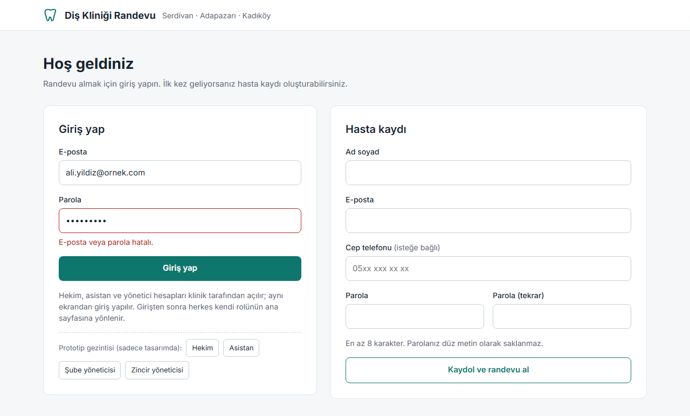

### 2a · Randevu al: şube, bölüm, hizmet, hekim

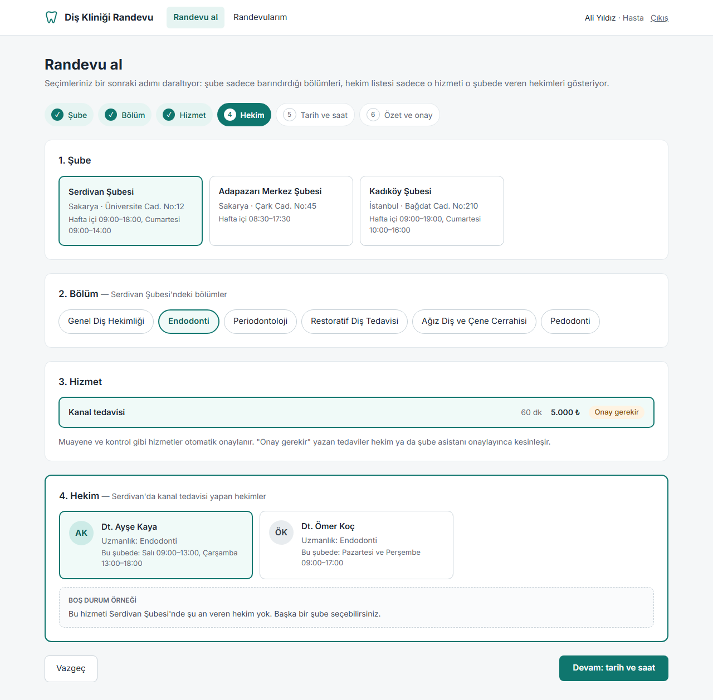

### 2b · Randevu al: tarih/saat, özet ve onay

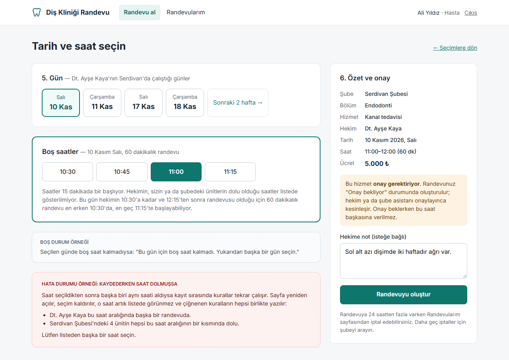

### 3 · Randevularım

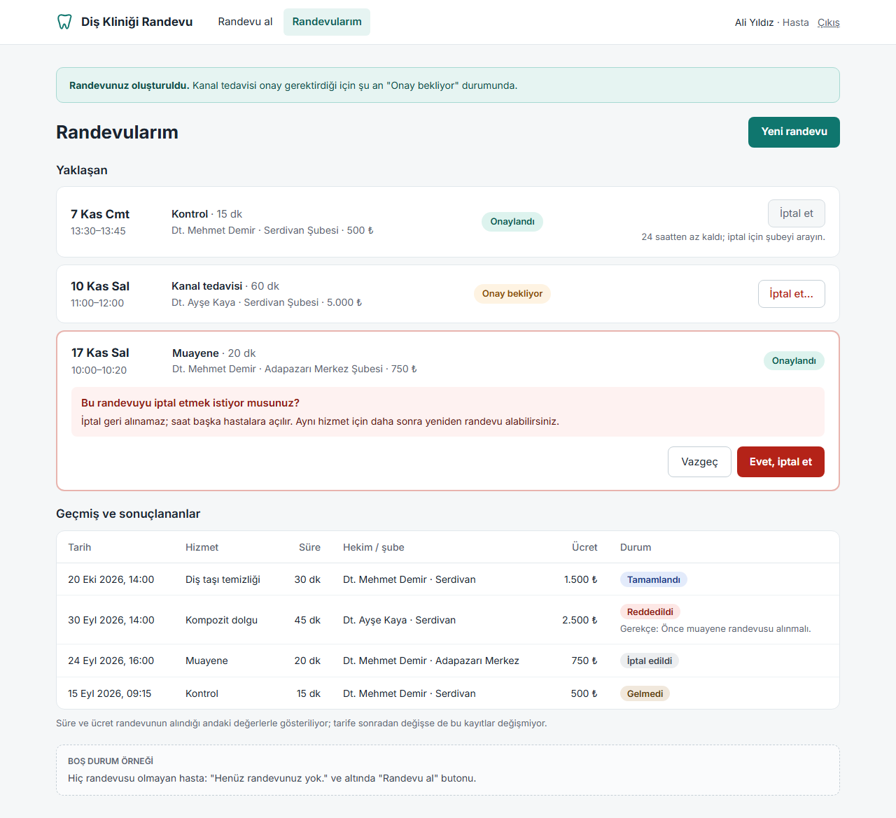

### 4a · Hekim: günlük takvim

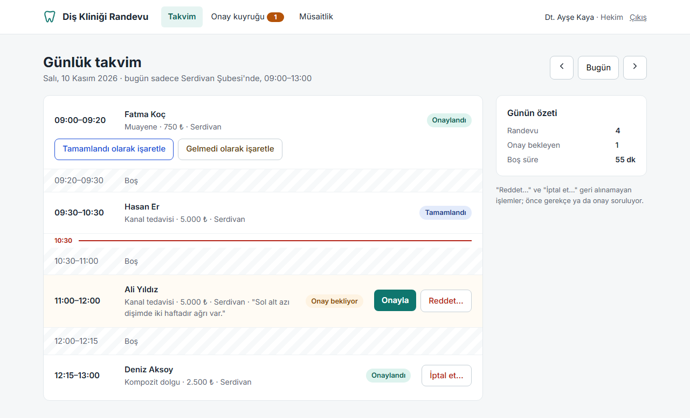

### 4b · Asistan: onay kuyruğu

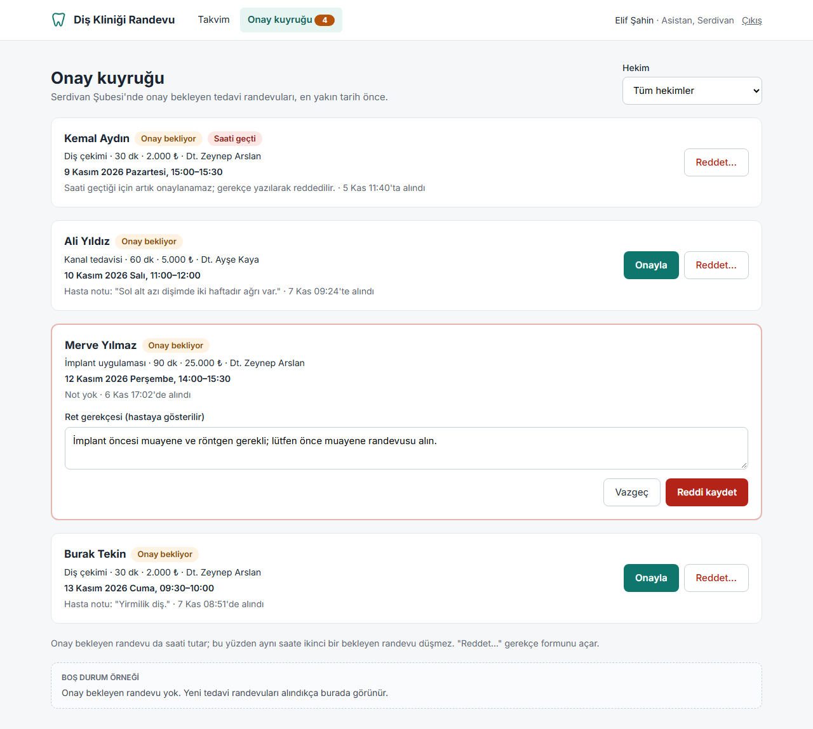

### 4c · Hekim: müsaitlik aralıkları

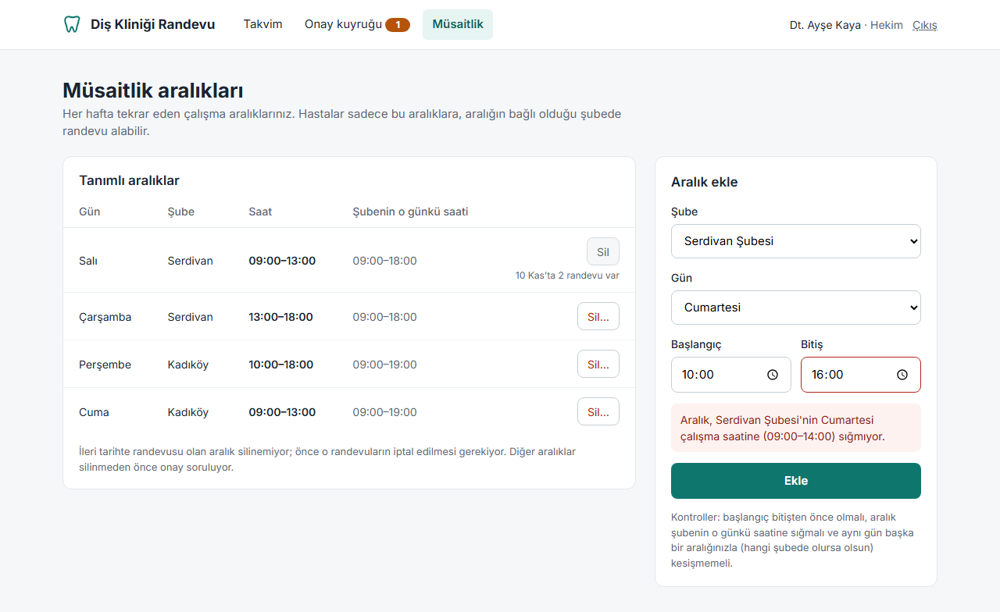

### 5a · Zincir yöneticisi: şubeler ve çalışma saatleri

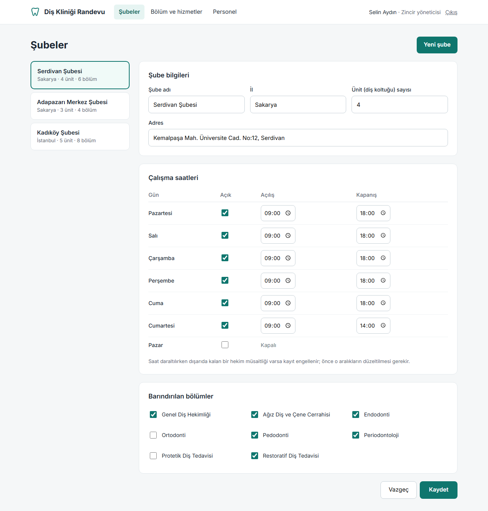

### 5b · Zincir yöneticisi: bölümler ve hizmetler

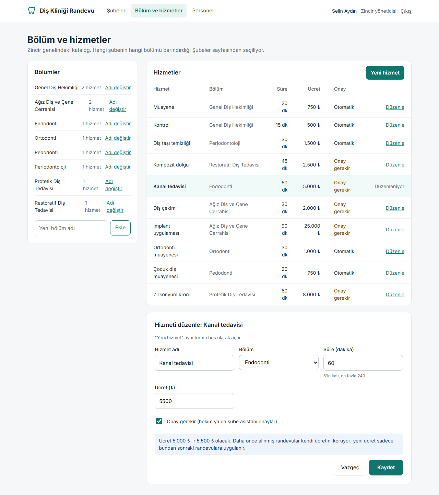

### 5c · Şube yöneticisi: şube personeli

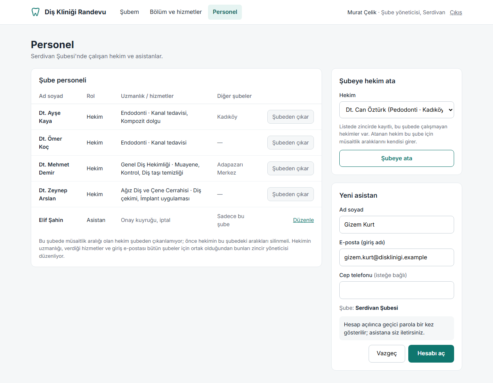

### 5d · Zincir yöneticisi: hekim kaydı

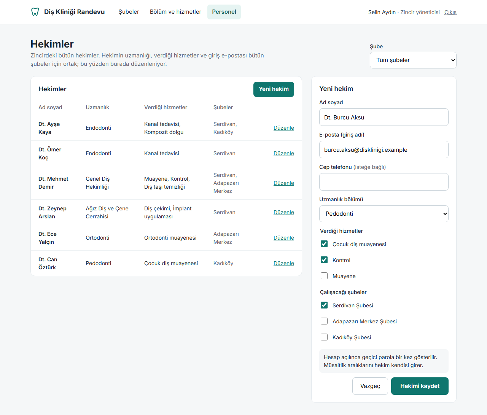

## Kodlanma durumu

| Gün | Kodlanan |
|---|---|
| 11 Kas | Ekran 1 (giriş ve hasta kaydı), ortak sayfa düzeni (role göre üst menü, kullanıcı satırı, çıkış), "yetki yok" sayfası. Renkler `site.css`'te değişken olarak; Bootstrap'in renkleri bunlarla değiştirildi. Diğer ekranların yerinde şimdilik "bu ekran X günü kodlanacak" yazan sayfa var (K44). |
| 12 Kas | Ekran 2a (şube, bölüm, hizmet, hekim; adım göstergesi, "Onay gerekir" rozeti, hekim yok boş durumu), ekran 2b (gün, boş saatler, özet kartı, hekime not, boş gün ve "kaydederken saat dolmuşsa" durumu), ekran 3 (yaklaşan randevular, iptal onay adımı, 24 saat kala pasif buton ve nedeni, geçmiş tablosu, ret gerekçesi, bütün durum rozetleri, boş durum). Ortak düzene sayfa üstü hata mesajı eklendi. Tasarımdaki kesikli "örnek" kutuları uygulamada sadece o durum gerçekten oluşunca görünüyor. |
| 13 Kas | Ekran 4a (günlük takvim: randevular ve boş aralıklar, "şu an" çizgisi, önceki/sonraki gün ve "Bugün", duruma göre Onayla / Reddet… / Tamamlandı ve Gelmedi olarak işaretle / İptal et…, günün özeti; asistanda hekim seçici), ekran 4b (onay kuyruğu: hasta notu ve alınma zamanı, "Saati geçti" rozetli ve sadece "Reddet…" olan kart, ret gerekçesi formu, asistanda hekim filtresi, boş durum), ekran 4c (aralık tablosu, şubenin o günkü saati, ileri tarihte randevusu olan aralıkta pasif "Sil" ve nedeni, silmeden önce onay, aralık ekleme formu ve kurala takılınca alan sınıfının mesajı). Üst menüde onay kuyruğunun yanında bekleyen sayısı. |
| 14 Kas | Ekran 5a (şube listesi, şube bilgileri ve ünit sayısı, yedi günün çalışma saatleri, barındırılan bölümler, "Yeni şube"; şube yöneticisinde başlık "Şubem" ve sadece kendi şubesi, sol liste yok), ekran 5b (bölümler ve hizmet sayıları, "Adı değiştir", yeni bölüm, hizmet tablosu, "Yeni hizmet" ve "Düzenle", düzenlenen satır vurgulu, ücret değişikliği notu; şube yöneticisinde salt okunur), ekran 5c (şube personeli, "Şubeden çıkar…" ve onay adımı, şubeye hekim atama, yeni asistan ve geçici parolanın bir kez gösterilmesi; zincir yöneticisinde şube seçici), ekran 5d (hekim tablosu, şube filtresi, yeni hekim ve "Düzenle" aynı formda, hizmetler bölüme göre gruplu). Yer tutucu sayfa kaldırıldı; bütün ekranlar kodlandı. |

Giriş ekranı tasarımındaki "Prototip gezintisi" bağlantıları sadece tasarımda ekranlar arasında
gezinmek için olduğundan uygulamaya alınmadı.

Tasarımdan bilerek ayrıldığım noktalar (12–14 Kasım):

| Ekran | Tasarımda | Uygulamada | Neden |
|---|---|---|---|
| 2a | "Serdivan'da kanal tedavisi yapan hekimler" | "Serdivan Şubesi'nde kanal tedavisi yapan hekimler" | Şubenin kısa adı modelde yok; tam adı ve K48'deki ek yardımcısı kullanıldı. |
| 2b | "Dt. Ayşe Kaya'nın Serdivan'da çalıştığı günler" | "hekimin bu şubede çalıştığı günler" | Kişi adına iyelik eki ("Kaya'nın") için ikinci bir dil kuralı yazmak gerekirdi; hekim ve şube zaten özet kartında yazıyor. |
| 2b | Boş saatlerin altında o güne özel açıklama ("10:30'a kadar ve 12:15'ten sonra randevusu olduğu için…") | Sadece genel açıklama (15 dakikalık adım, dolu saatlerin gösterilmediği) | O cümle tasarımdaki örnek güne göre elle yazılmıştı; her gün için üretmek ayrı bir metin üretici demek. |
| 2b | Sadece onay gerektiren hizmet için turuncu bilgi kutusu | Otomatik onaylı hizmette yeşil "otomatik onaylanır" kutusu | Tasarımda bu durumun örneği yoktu; hasta iki durumda da ne olacağını görsün diye. |
| 2b | "Sonraki 2 hafta →" | Ayrıca "← Önceki 2 hafta" (ilk pencerede yok) | İleri gidince geri dönmenin tek yolu tarayıcının geri tuşu oluyordu. |
| 3 | Geçmiş tablosunda şube kısa adıyla ("Serdivan") | Şubenin tam adı | 2a'daki ile aynı neden. |
| 3 | "Saati geçti" rozeti sadece onay kuyruğunda | Hastanın geçmiş tablosunda da (onaylanmadan saati gelen randevu) | K28'deki durum hastaya da görünmeli; yoksa "Onay bekliyor" yazan geçmiş bir randevu kafa karıştırırdı. |
| 4a | Alt başlıkta "bugün sadece Serdivan Şubesi'nde, 09:00–13:00" | "Serdivan Şubesi'nde 09:00–13:00" (birden fazla aralık varsa virgülle) | "Sadece" ve "bugün" kelimeleri günün durumuna göre ayrı cümleler gerektiriyordu; aralıkların listesi aynı bilgiyi veriyor. |
| 4a, 4b | Hekim seçici / filtresi sadece açılır liste | Açılır liste + "Göster" butonu | Sayfalar JavaScript'siz çalışıyor ("Ortak kararlar"); seçim değişince formu gönderecek bir şey yok. |
| 4b | "7 Kas 09:24'te alındı" | "alınma: 7 Kas 09:24" | Saate gelen ek ("'te", "'da") saatin okunuşuna bağlı; şube adlarındaki ek yardımcısı (K48) sayıları okuyamıyor. |
| 4b | Hekimin kuyruğunda da sadece hekim adı | Hekimin kuyruğunda şube adı da yazıyor | Hekim birden fazla şubede çalışabiliyor; asistanın kuyruğu tek şube olduğu için orada yazılmıyor. |
| 4c | Hata "Aralık, Serdivan Şubesi'nin Cumartesi çalışma saatine (09:00–14:00) sığmıyor." | "10:00–16:00 aralığı, Serdivan Şubesi Cumartesi çalışma saatine (09:00–14:00) sığmıyor." | Mesaj alan sınıfından (`Dentist.AddAvailability`, 7 Kasım) olduğu gibi geliyor; ilgi eki için ikinci bir dil kuralı yazmadım. Hangi aralığın reddedildiği de görünüyor. |
| 4c | Silinemeyen aralıkta "10 Kas'ta 2 randevu var" | Randevular farklı günlerdeyse "3 randevu var; ilki 10 Kas'ta" | Tasarımdaki örnekte randevular tek gündeydi; birden fazla gün için bir biçim gerekiyordu. |
| 5a | Şube yöneticisi için ayrı bir görünüm yok | "Şubem" başlığı, sol şube listesi ve "Yeni şube" yok | Tek şubelik listenin bir anlamı yok; şube açmak zincir yöneticisinin işi (K54). |
| 5a | Saat alanında tarayıcıya göre değişen saat seçici | Aynı; ayrıca "Açık" işareti kaldırılan günün saatleri yok sayılıyor | Kapalı gün için saat silmeyi zorunlu kılmak gereksiz bir adım olurdu. |
| 5b | Ücret değişikliği notu eski ve yeni ücreti yazarken gösteriliyor ("5.000 ₺ → 5.500 ₺ olacak") | Formda şu anki ücret ve genel not; eski → yeni ücret kayıttan sonra mesajda | Yazarken güncellemek JavaScript demekti; sayfalar JavaScript'siz ("Ortak kararlar"). |
| 5b | Ücret alanı | Tam lira (kuruşsuz) | Sayı alanı noktalı ondalık gönderiyor, Türkçe kültürde nokta binlik ayracı; 5500.50 yanlış okunurdu. Örnek ücretlerin hepsi tam lira. |
| 5c, 5d | Yeni personel formunda "Cep telefonu (isteğe bağlı)" | Alan yok | Personel telefonu sistemde hiçbir yerde kullanılmıyor; sütun ve migration eklemedim (K57). |
| 5c | Asistan satırında "Düzenle" | Yok | Asistan hesabını düzenlemek ödevin "kayıt" maddesinin dışında kaldı (K57). |
| 5c | Diğer şubelerde kısa ad ("Kadıköy") | Şubenin tam adı | 2a'daki ile aynı neden. |
| 5d | Verdiği hizmetler listesi uzmanlığa göre daraltılmış görünüyor | Bütün hizmetler, bölüme göre gruplu | Hekimin verdiği hizmetler uzmanlığıyla sınırlı değil (endodontist dolgu da yapabiliyor, `Dentist.Specialty` açıklaması). |
| 5d | "Yeni hekim" butonu her zaman | Sadece bir hekim düzenlenirken (form zaten yeni hekim formu değilken) | Form sayfada hep açık; buton yeni hekim formuna dönmek için. |

## Ortak kararlar

- **Renkler:** açık gri zemin, beyaz kartlar, ana renk petrol yeşili. Durum rozetleri hem renk hem
  yazıyla ayrışıyor (Onay bekliyor, Onaylandı, Reddedildi, İptal edildi, Tamamlandı, Gelmedi,
  Saati geçti); sadece renge güvenmiyorum.
- **Üst menü role göre değişiyor.** Hasta: Randevu al, Randevularım. Hekim: Takvim, Onay kuyruğu,
  Müsaitlik. Asistan: Takvim, Onay kuyruğu. Yönetici: Şubeler (şube yöneticisinde "Şubem"),
  Bölüm ve hizmetler, Personel.
- **Butonlar yetkiye ve duruma göre çıkıyor.** Örneğin onaylı randevuda "Onayla" yok; "Tamamlandı"
  sadece saati gelmiş onaylı randevuda var. Bu, kodda `CanApprove` / `CanCancel` ve State deseninin
  ekrandaki karşılığı.
- **Geri alınamayan işlemler önce sorar.** İptal, ret ve silme butonlarında "…" var; önce onay ya da
  gerekçe isteniyor.
- **Hastaya sadece boş saatler gösteriliyor.** Kaydederken aynı kurallar tekrar çalıştığı için
  arada saat dolarsa çiğnenen kuralların hepsi birlikte gösteriliyor (tasarim.md bölüm 3).
- **Seçim akışı basit formlarla.** Randevu alma adımları JavaScript gerektirmiyor; her seçimde sayfa
  sorgu parametreleriyle yeniden yükleniyor.
- **Telefon genişliği:** menü ve kartlar alt alta diziliyor, tablolar kendi kutusunda yatay kayıyor.
- Sayfalar Bootstrap'in hazır görünümüne yakın tutuldu, böylece kodlarken ek CSS kütüphanesi gerekmeyecek.

## Tasarımda ortaya çıkan küçük kararlar

Ekranları çizerken alan modelinde olmayan birkaç ayrıntı çıktı. Durumları:

1. Boş saatler **15 dakikada bir** başlıyor. *Kodda var (K32, 9 Kasım).*
2. Hasta randevu alırken **hekime kısa bir not** yazabiliyor; kuyrukta randevunun **ne zaman alındığı**
   görünüyor. *Onaylandı (K35), kodda var (10 Kasım).*
3. Reddederken **gerekçe** yazılıyor ve hastaya gösteriliyor. *Kodda var (`RejectionReason`).*
4. İleri tarihte randevusu olan müsaitlik aralığı **silinemiyor**; şube çalışma saati daraltılırken
   dışarıda kalan müsaitlik varsa kayıt engelleniyor. Etkilenen kayıtların listelenmesi kapsam dışı.
   *Kodda var (K52, 13 Kasım; K56, 14 Kasım). Mesaj ilk aralığı hekim adıyla ve toplam sayıyı söylüyor.*
5. Personel hesabı yönetici tarafından **geçici parolayla** açılıyor; ilk girişte değiştirme zorunlu
   değil (K36). *Kodda var (K55, 14 Kasım).*

## Bağımsız inceleme (9 Kasım)

Tasarımı çizen değil, ayrı bir inceleyici ekranları ödev maddeleri, tasarim.md ve Core'daki kodla
karşılaştırdı. Yüksek önemde bulgu çıkmadı; ödev maddelerinin hepsi en az kısmen karşılanıyordu.
Orta önemdeki bulgular ve yapılanlar:

| Bulgu | Yapılan |
|---|---|
| Boş saat örneği kurallarla üretilemezdi (11:30 ve 12:00 var, 11:45 yok; takvimdeki randevularla çelişiyordu) | Liste takvimdeki randevulardan yeniden hesaplandı: 10:30, 10:45, 11:00, 11:15 |
| K28'deki "saati geçmiş bekleyen randevu" hiçbir ekranda yoktu | Kuyruğa "Saati geçti" rozetli, sadece "Reddet" butonu olan kart eklendi |
| Hekim menüsündeki kuyruk sayısı (3) hekimin göremeyeceği randevuları sayıyordu | Hekim ekranlarında 1 (kendi bekleyen randevusu) |
| İleri tarihte randevusu olan müsaitlik aralığında "Sil" etkindi | Pasif buton ve gerekçe; diğer satırlarda silmeden önce onay |
| Şube yöneticisi hekimin bütün şubeleri etkileyen bilgilerini düzenleyebiliyordu | Yetki ayrıldı: 5c şube yöneticisi, yeni 5d zincir yöneticisi (K34) |
| Yeni personel formu yoktu | 5c'de yeni asistan, 5d'de yeni hekim formu |
| Yeni hizmet için giriş noktası yoktu | "Yeni hizmet" butonu, satır başına "Düzenle", bölüm için "Adı değiştir" |
| İptal tek tıkla yapılıyor gibiydi | Randevularım'a iptal onay adımı eklendi |
| Boş durumlar yoktu | Hekim listesi, boş gün, boş kuyruk ve randevusu olmayan hasta için örnekler |

Düşük önemli bulgulardan yapılanlar: hata örneği "seçim kaldırılır, saat listeden çıkar" olarak
yeniden yazıldı; ret iki ekranda aynı formu kullanıyor; "hekim onayı / hekim veya asistan onayı"
yerine tek ifade "Onay gerekir"; katalogda bölümlerin tam adı; kuyruk filtresine eksik hekim
eklendi; örnek geçmiş tarihler hekimin müsaitliğine ve 15 dakikalık adıma uyduruldu; "Tamamlandı
olarak işaretle" / "Gelmedi olarak işaretle" buton adları; "şu an" çizgisi doğru yere alındı;
pasif butonlar `aria-disabled` ile klavyeyle odaklanabilir; kayıt formunda ad soyad tek alan ve
telefon isteğe bağlı; geçmiş randevularda süre sütunu; süre alanına üst sınır (240); müsaitlik
ekranındaki tabloyla aynı bilgiyi veren haftalık görünüm kaldırıldı.

## Koda yansıyacak işler

İnceleme koddaki birkaç noktayı da gösterdi. Plandaki ilgili günde yapılacaklar:

| Gün | İş |
|---|---|
| 10 Kas | ✓ Yapıldı. `Appointment`'a hasta notu (en fazla 500 karakter) ve oluşturulma zamanı (K35). `Dentist` hata mesajlarındaki "Serdivan Şubesi şubesinde" tekrarı düzeltildi; şube adı artık kural mesajlarındaki gibi parantez içinde yazıyor ("… bu şubede çalışmıyor (Serdivan Şubesi)"). |
| 12 Kas | ✓ Yapıldı. Kural mesajları ekrandaki metinle aynı: "Dt. Ayşe Kaya bu saat aralığında başka bir randevuda." ve "Serdivan Şubesi'ndeki 4 ünitin hepsi bu saat aralığının bir kısmında dolu." Şube adına ek `TurkishNames.Locative` ile getiriliyor (K48). |
| 13 Kas | ✓ Yapıldı. İleri tarihte aktif randevusu olan müsaitlik aralığı silinemiyor; kural `AvailabilityService.RemoveAsync`'te (K52). `BranchManager.CanCancel` ve `ChainAdministrator.CanCancel` artık `false`, yetki tablosu testleri güncellendi (K34). |
| 14 Kas | ✓ Yapıldı. Hekim kaydı ve ortak bilgileri sadece zincir yöneticisi (`CanManageChain`, K54); şube yöneticisi atama/çıkarma ve asistan hesabı (`CanManageBranch`). Şube saati daraltılırken dışarıda kalan müsaitlik kontrolü `BranchAdministrationService`'te (K24, K56). |
