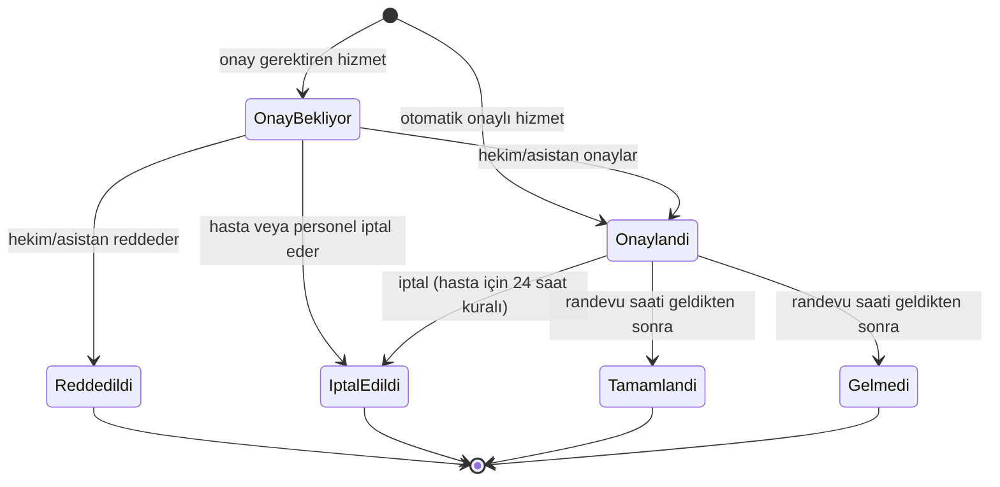
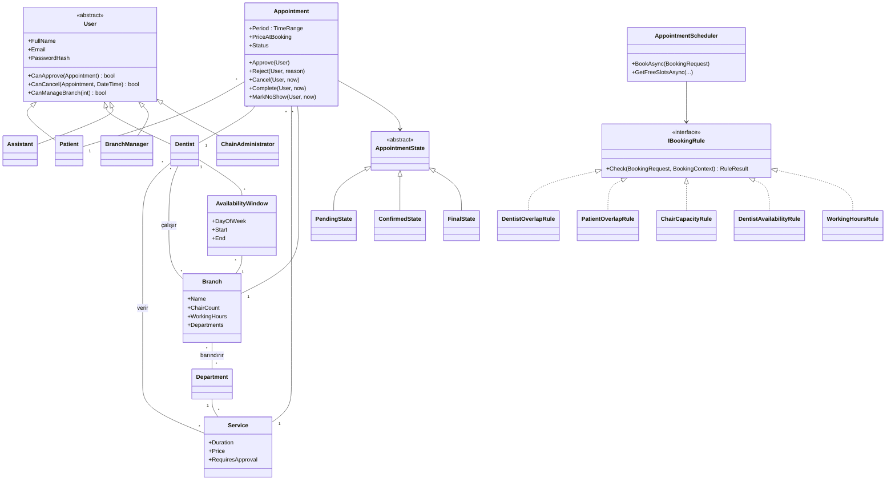

# Tasarım Dokümanı

Bu doküman projenin alan modelini, iş kurallarını ve verdiğim tasarım kararlarını
gerekçeleriyle anlatıyor. Kod ilerledikçe güncelleniyor; son hali README'deki
UML diyagramları ve SOLID tablosuyla birlikte okunmalı.

## 1. Alan: çok şubeli diş kliniği zinciri

Ödevdeki "hastane/klinik randevu sistemi"ni bir diş kliniği zincirine uyarladım.
Diş kliniği seçmemin sebebi, genel hastaneye göre kaynakların daha somut olması:
bir randevu sadece hekimi değil, şubedeki bir **ünit**i (diş koltuğu) de meşgul ediyor.
Bu da çakışma kontrolünü "aynı hekim aynı saatte iki yerde olamaz"dan daha ilginç hale getiriyor.

### 1.1 Kavramlar

| Kavram | Açıklama |
|---|---|
| **Şube** | Zincirin bir kliniği. Adı, adresi, haftalık çalışma saatleri, ünit sayısı ve barındırdığı bölümler var. Tek klinikli bir kurum, tek şubeli bir zincir olarak aynı modelle temsil ediliyor. |
| **Çalışma saatleri** | Şubenin haftanın her günü için açılış/kapanış saati. Kapalı günler kayıt olarak tutulmuyor. |
| **Ünit** | Diş koltuğu. Şubede kaç ünit varsa aynı anda en fazla o kadar randevu yürüyebilir. |
| **Bölüm** | Diş hekimliği dalı. Zincir genelinde bir katalog var; her şube bunlardan hangilerini barındırdığını seçiyor. |
| **Hizmet** | Bir bölüme ait tedavi. Süresi (dakika), ücreti (₺) ve onay gerektirip gerektirmediği tanımlı. |
| **Hekim** | Uzmanlık alanı (bir bölüm), verdiği hizmetler ve çalıştığı şubeler tanımlı. Bir hekim birden fazla şubede çalışabilir (ör. Salı Serdivan, Perşembe Kadıköy). |
| **Asistan** | Sağlık personeli. Bir şubeye bağlı; o şubenin onay kuyruğunu yönetir. |
| **Müsaitlik aralığı** | Hekimin belirli bir şubede, haftanın belirli bir günü çalıştığı saat aralığı (ör. Salı 09:00–13:00, Serdivan). Hastalar sadece bu aralıklara randevu alabilir. |
| **Randevu** | Hasta + hekim + hizmet + şube + başlangıç/bitiş. Oluşturulduğu andaki hizmet adı, süre ve ücret randevuya kopyalanıyor (bkz. K9). |

### 1.2 Bölümler (örnek veri)

Genel Diş Hekimliği, Ağız Diş ve Çene Cerrahisi, Endodonti, Ortodonti, Pedodonti
(çocuk diş hekimliği), Periodontoloji (diş eti), Protetik Diş Tedavisi, Restoratif Diş Tedavisi.

### 1.3 Hizmetler (örnek veri)

Ücretler gerçek tarifeden alınmadı, sadece örnek.

| Hizmet | Bölüm | Süre | Ücret | Onay |
|---|---|---|---|---|
| Muayene | Genel Diş Hekimliği | 20 dk | 750 ₺ | Otomatik |
| Kontrol | Genel Diş Hekimliği | 15 dk | 500 ₺ | Otomatik |
| Diş taşı temizliği | Periodontoloji | 30 dk | 1.500 ₺ | Otomatik |
| Kompozit dolgu | Restoratif | 45 dk | 2.500 ₺ | Hekim/asistan onayı |
| Kanal tedavisi | Endodonti | 60 dk | 5.000 ₺ | Hekim/asistan onayı |
| Diş çekimi | Cerrahi | 30 dk | 2.000 ₺ | Hekim/asistan onayı |
| İmplant uygulaması | Cerrahi | 90 dk | 25.000 ₺ | Hekim/asistan onayı |
| Ortodonti muayenesi | Ortodonti | 30 dk | 1.000 ₺ | Otomatik |
| Çocuk diş muayenesi | Pedodonti | 20 dk | 750 ₺ | Otomatik |
| Zirkonyum kron | Protetik | 60 dk | 8.000 ₺ | Hekim/asistan onayı |

### 1.4 Roller ve yetkileri

| Rol | Neler yapabilir |
|---|---|
| **Hasta** | Kayıt olur, şube → bölüm → hizmet → hekim → saat seçerek randevu alır, randevularını görür, 24 saatten fazla varsa iptal eder. |
| **Hekim** | Kendi müsaitlik aralıklarını tanımlar, kendi randevularını onaylar/reddeder, randevuyu tamamlandı/gelmedi olarak işaretler. |
| **Asistan** (sağlık personeli) | Bağlı olduğu şubenin onay kuyruğunu yönetir, şubedeki randevuları iptal edebilir. |
| **Şube yöneticisi** | Sadece kendi şubesinin çalışma saatlerini, bölümlerini, ünit sayısını ve personelini yönetir. |
| **Zincir yöneticisi** | Şube açar/kapatır, hizmet kataloğunu yönetir, tüm şubelerde şube yöneticisinin yapabildiği her şeyi yapar. |

Ödevdeki "Hastane/Klinik Yöneticisi" rolü iki seviyeye bölündü (bkz. K3).

## 2. Randevu yaşam döngüsü

Geçerli olmayan her geçiş (ör. onaylanmış randevuyu tekrar onaylamak, reddedilmiş
randevuyu iptal etmek, saati gelmemiş randevuyu "tamamlandı" yapmak) `DomainException`
fırlatıyor ve birim testleriyle sınanıyor.

**İptal kuralı:** Hasta, randevusuna 24 saatten fazla varsa kendisi iptal edebilir.
Daha geç iptali sadece klinik personeli (hekim, asistan, yönetici) yapabilir; çünkü
son dakika iptallerinde boşalan ünitin başka hastaya verilmesi personelin işi.

## 3. Çakışma kontrolü (sistemin asıl iş kuralı)

Randevu oluşturulurken aşağıdaki kuralların **hepsi** kontrol ediliyor ve çiğnenen
kuralların tamamı kullanıcıya birlikte gösteriliyor (ilk hatada durmak yerine).
Aynı kurallar, hastaya gösterilecek boş saatleri üretirken de kullanılıyor; yani
"ekranda boş görünen saat" ile "kaydederken kabul edilen saat" aynı koddan çıkıyor.

| # | Kural | Açıklama |
|---|---|---|
| 1 | Geçmişe randevu yok | Başlangıç şu andan sonra olmalı. |
| 2 | Hekim bu hizmeti veriyor | Seçilen hizmet hekimin hizmet listesinde olmalı ve şube o bölümü barındırmalı. |
| 3 | Şube çalışma saati | Randevu, şubenin o günkü açılış–kapanış aralığına tamamen sığmalı. |
| 4 | Hekim müsaitliği | Randevu, hekimin **o şubedeki** o günkü müsaitlik aralıklarından birine tamamen sığmalı. |
| 5 | Hekim çakışması | Hekimin **herhangi bir şubede** bu saatle kesişen aktif randevusu olmamalı. |
| 6 | Hasta çakışması | Hastanın herhangi bir şubede bu saatle kesişen aktif randevusu olmamalı. |
| 7 | Ünit kapasitesi | Randevu süresi boyunca şubede aynı anda yürüyen randevu sayısı ünit sayısını aşmamalı. |

"Aktif randevu" = Onay Bekliyor veya Onaylandı durumundaki randevu (bkz. K5).

**Zaman aralıkları yarı açık:** `[başlangıç, bitiş)`. 10:00–10:30 ve 10:30–11:00
randevuları çakışmıyor; arka arkaya randevu verilebiliyor.

**Ünit kapasitesinde dikkat edilen nokta:** Sadece "kesişen randevu sayısı < ünit sayısı"
demek yanlış sonuç veriyor. Örnek: 2 ünitli şubede 09:00–09:30 ve 09:30–10:00
randevuları var; 09:00–10:00 için yeni randevu istendiğinde iki randevuyla da kesişiyor
ama aynı anda en fazla **bir** randevu yürüyor, yani bir ünit hep boş. Bu yüzden istenen
aralık içindeki **en yüksek eş zamanlı randevu sayısı** hesaplanıyor (başlangıç/bitiş
noktaları sıralanıp taranarak). Bu durum için ayrı bir birim testi yazılacak.

## 4. Tasarım kararları

Her kararda neyi seçtiğimi, neden seçtiğimi ve neyi bilerek seçmediğimi yazdım.

### Alan kararları

**K1 – Çakışma kaynakları: hekim, hasta ve ünit.**
Hekim ve hasta çakışması her randevu sisteminde var; ünit kapasitesini diş kliniğine özgü
olduğu için ekledim. *Alternatif:* sterilizasyon/temizlik payı (her tedaviden sonra
ünitin 10–15 dk kapalı kalması). Gerçekçi ama zaman hesabını ve testleri karmaşıklaştırdığı
için kapsam dışı bıraktım; kural yapısı (K12) sayesinde sonradan yeni bir kural sınıfı
olarak eklenebilir.

**K2 – Onay hizmete göre belirleniyor.**
Muayene, kontrol gibi kısa ve riski düşük hizmetler otomatik onaylanıyor; kanal, implant
gibi tedaviler hekimin hastayı ve süreyi değerlendirmesi gerektiği için "Onay Bekliyor"da
kalıyor. Bunu hizmette bir `RequiresApproval` alanı ile tuttum. *Alternatif:* `Service`
sınıfından `ExaminationService` / `TreatmentService` gibi alt sınıflar türetmek. Bu iki
türün tek davranış farkı onay olduğu için kalıtım burada gereksiz karmaşıklık olurdu;
kalıtımı davranışın gerçekten farklılaştığı yerlerde (kullanıcılar, randevu durumları) kullandım.

**K3 – İki seviyeli yönetici: zincir yöneticisi ve şube yöneticisi.**
Ödevdeki "yetki çerçevesinde tanımlanabilir" ifadesini böyle karşıladım: şube yöneticisi
yalnızca kendi şubesini yönetebiliyor. Tek klinikli kurumda zincir yöneticisi tek şubeyi
yönetir, şube yöneticisi tanımlamaya gerek kalmaz. *Alternatif:* tek yönetici rolü;
basit ama yetki sınırı olmadığı için maddeyi zayıf karşılıyor.

**K4 – Hasta için 24 saat iptal kuralı.** Bkz. bölüm 2. Zamana bağlı bir kural olduğu
için test edilebilmesi adına zamanı `TimeProvider` ile alıyorum (K16).

**K5 – Onay bekleyen randevu da saati tutuyor.**
Bekleyen randevular çakışma kontrolünde sayılmazsa aynı saate birden fazla bekleyen randevu
oluşabilir ve onaylayan kişi hangisini seçeceğine karar vermek zorunda kalır. Hasta da
"aldım" sandığı saati kaybedebilir. Reddedilen ya da iptal edilen randevu saati hemen
serbest bırakıyor.

**K6 – Ünitler sayı olarak tutuluyor, tek tek varlık olarak değil.**
Kapasite kontrolü için şubedeki ünit sayısı yeterli. *Alternatif:* her ünit ayrı kayıt ve
randevuya belirli bir ünit atanması. Ünit bazlı ekipman farkı (ör. sadece bir ünitte
röntgen var) olsaydı gerekirdi; bu projede yok.

**K7 – Tek kurum, çok şube (çok kiracılı değil).**
Sistem tek bir zincir için kuruluyor. Birden fazla bağımsız kurumu aynı veritabanında
barındırmak (multi-tenant) ödevin istediği bir şey değil ve her sorguya kurum filtresi
eklemeyi gerektirirdi.

**K8 – Müsaitlik haftalık tekrar eden aralıklar olarak ve şube bazında tutuluyor.**
Hekimlerin çalışma düzeni genelde haftalık sabit. Aralığın şubeye bağlı olması, bir hekimin
farklı günlerde farklı şubelerde çalışmasını mümkün kılıyor ve hekim çakışmasının şubeler
arası kontrol edilmesini anlamlı yapıyor. *Alternatif:* tarih bazlı tek tek aralıklar;
esnek ama hekimin her hafta yeniden girmesi gerekir. İzin günleri ileride ayrı bir
"müsait değil" kaydıyla eklenebilir.

**K9 – Randevu oluşturulduğu andaki süre ve ücreti saklıyor.**
Ödev randevuda hizmet, süre, ücret, personel ve tarih/saatin kaydedilmesini istiyor.
Bunları sadece hizmete referans olarak tutsaydım, yönetici hizmet ücretini değiştirdiğinde
geçmiş ve gelecek randevuların ücreti de değişmiş gibi görünürdü. Bu yüzden randevuya
o anki değerlerin bir kopyası yazılıyor.

**K10 – Saatler yerel saat olarak tutuluyor.**
Tüm şubeler Türkiye'de ve Türkiye'de yaz saati uygulaması yok, bu yüzden saat dilimi
dönüşümüne gerek görmedim. SQLite `DateTimeOffset` üzerinde sıralama ve karşılaştırmayı
iyi desteklemediği için `DateTime` kullanılıyor.

### Teknik kararlar

**K11 – Katmanlar: Core, Web, Tests.**
`DisKlinigi.Core` alan sınıflarını, iş kurallarını ve arayüzleri içeriyor; hiçbir altyapı
paketine bağımlı değil. `DisKlinigi.Web` MVC arayüzünü ve EF Core ile veri erişimini içeriyor.
`DisKlinigi.Tests` sadece Core'u test ediyor. Böylece çakışma kuralları veritabanı ve web
sunucusu olmadan, milisaniyeler içinde test edilebiliyor. *Alternatif:* ayrı bir
Infrastructure projesi (klasik Clean Architecture). Bu boyutta bir projede veri erişimini
Web içinde bir klasörde tutmak yeterli; ayrı proje sadece tören eklerdi.

**K12 – Çakışma kuralları Strategy deseniyle ayrı sınıflar.**
Her kural `IBookingRule` arayüzünü uygulayan ayrı bir sınıf. Randevu planlayıcı
(`AppointmentScheduler`) kuralların listesini DI ile alıp hepsini sırayla çalıştırıyor;
hangi kuralın ne yaptığını bilmiyor. Yeni kural eklemek mevcut kodu değiştirmeden yeni
bir sınıf eklemek demek (Open/Closed). Her kural tek başına test edilebiliyor.
*Alternatif:* tek bir büyük `Validate()` metodu; başta daha kısa ama kural sayısı arttıkça
okunmaz ve test edilmesi zor hale gelir.

**K13 – Randevu durumları State deseniyle.**
Her durum (`PendingState`, `ConfirmedState`, ...) hangi işlemlere izin verdiğini kendisi
biliyor; izin verilmeyen işlem temel sınıfta varsayılan olarak hata fırlatıyor. Veritabanında
durum bir enum olarak saklanıyor, nesne yüklenince ilgili durum sınıfı seçiliyor.
*Alternatif:* `(durum, işlem) → yeni durum` şeklinde bir geçiş tablosu. Geçişlerde sadece
durum değişseydi tablo daha basit olurdu; ama bazı geçişlerin koşulu var (tamamlandı için
randevu saatinin gelmiş olması, hasta iptali için 24 saat), bu koşulları ilgili durumun
içinde tutmak daha okunur.

**K14 – Kullanıcılar kalıtım hiyerarşisi, EF Core'da tek tablo (TPH).**
`User` soyut sınıfından `Patient`, `Dentist`, `Assistant`, `BranchManager`,
`ChainAdministrator` türüyor. Yetki soruları (`CanApprove(randevu)`, `CanCancel(randevu, şimdi)`,
`CanManageBranch(şube)`) her sınıfta farklı cevaplanıyor: hekim sadece kendi randevusunu,
asistan kendi şubesinin randevusunu onaylayabiliyor; hasta ise hiç onaylayamıyor. Controller'da
`if (rol == ...)` zincirleri yerine bu çok biçimli metotlar çağrılıyor. Tek tablo seçmemin
sebebi giriş sırasında e-postaya göre tek sorguyla kullanıcıyı bulabilmek.
*Alternatif:* tek `User` sınıfı ve rol alanı; ama o zaman rol kontrolleri kod geneline dağılır.

**K15 – ASP.NET Core Identity yerine çerez kimlik doğrulaması + `PasswordHasher`.**
Identity kendi kullanıcı tablolarını ve hazır ekranlarını getiriyor; bu hem K14'teki
hiyerarşiyle çakışıyor hem de kimlik doğrulamanın nasıl çalıştığını gizliyor. Bunun yerine
ASP.NET Core'un çerez kimlik doğrulamasını kullanıp parolaları framework'ün `PasswordHasher`
sınıfıyla (PBKDF2, tuzlu) saklıyorum. Parolalar hiçbir yerde düz metin tutulmuyor. Core'da
`IPasswordHasher` adında kendi arayüzüm var, framework sınıfı Web'de bunun arkasına saklanıyor.

**K16 – Zaman `TimeProvider` ile alınıyor.**
.NET'in hazır `TimeProvider` soyutlaması kullanılıyor; testlerde `FakeTimeProvider` ile
"şu an" sabitlenip 24 saat kuralı ve geçmişe randevu kuralı deterministik test ediliyor.
Kendi `IClock` arayüzümü yazmak yerine standart olanı tercih ettim.

**K17 – Veri erişimi repository arayüzleri üzerinden.**
EF Core'un `DbContext`'i zaten bir unit of work, bu yüzden her tablo için genel amaçlı
(`IRepository<T>`) bir katman yazmadım. Sadece iş kurallarının ihtiyaç duyduğu sorgular için
amaca özel arayüzler var (ör. "hekimin bu gün aktif randevuları"). Core bu arayüzleri tanımlıyor,
Web EF Core ile gerçekleştiriyor (Dependency Inversion). Testlerde bellek içi sahte sınıflar kullanılıyor.

**K18 – Migration + açılışta otomatik örnek veri.**
Şema EF Core migration'larıyla yönetiliyor; uygulama açılırken bekleyen migration'lar
uygulanıyor ve veritabanı boşsa örnek veri yükleniyor. Sunum makinesinde `dotnet run`
dışında bir şey yapmaya gerek kalmıyor. *Alternatif:* `EnsureCreated()`; daha basit ama
model değiştiğinde veritabanını silmek gerekiyor ve şema geçmişi tutulmuyor.

**K19 – Eş zamanlı randevu denemeleri.**
İki hasta aynı anda aynı saate randevu almaya çalışırsa ikisi de kontrolü geçip kaydedebilir.
Bunu önlemek için kontrol ve kayıt tek bir veritabanı işlemi (transaction) içinde yapılacak;
ayrıntısı çakışma kontrolü gününde (9 Kasım) netleşecek ve README'ye yazılacak.

**K20 – Kod İngilizce, arayüz ve yorumlar Türkçe.**
Sınıf ve metot adlarında Türkçe karakter kullanmak (ı, ş, ğ) hem yazımı zorlaştırıyor hem
de framework adlarıyla karışık bir dil ortaya çıkarıyor. Kullanıcının gördüğü her şey ve
kod yorumları Türkçe.

**K21 – Yerel çalıştırma http üzerinden.**
macOS'te https geliştirme sertifikası ayrıca güvenilir yapılmayı gerektiriyor
(`dotnet dev-certs https --trust`). Sunumda sorun çıkmasın diye uygulama `http://localhost:5080`
adresinde açılıyor.

## 5. İlk sınıf taslağı

Bu taslak 7–9 Kasım'da kodlanacak; README'deki son diyagram koddan çıkarılacak.

## 6. Ekranlar

Ekranlar kod yazılmadan önce tasarım kanvasında çizilip onaylanacak (7 Kasım):

1. Giriş ve hasta kaydı
2. Hasta: randevu alma akışı (şube → bölüm → hizmet → hekim → tarih/saat → özet ve onay)
3. Hasta: randevularım (durum, iptal)
4. Hekim/asistan: günlük takvim, onay kuyruğu, müsaitlik aralıkları
5. Yönetici: şubeler, çalışma saatleri, bölümler, hizmetler, personel
