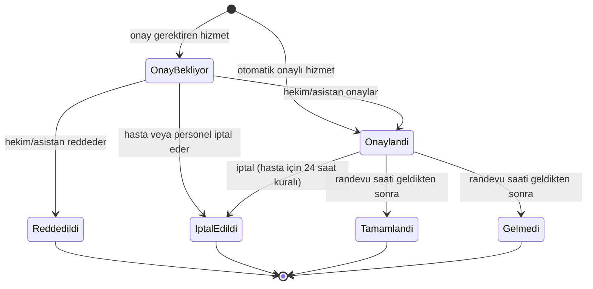
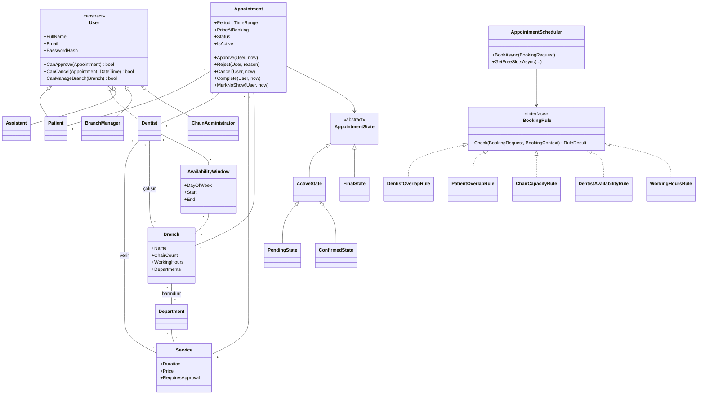

# Tasarım Dokümanı

Bu doküman projenin alan modelini, iş kurallarını ve verdiğim tasarım kararlarını
gerekçeleriyle anlatıyor. Kod ilerledikçe güncelleniyor; son hali README'deki
UML diyagramları ve SOLID tablosuyla birlikte okunmalı.

## 1. Alan: çok şubeli diş kliniği zinciri

Ödevdeki "hastane/klinik randevu sistemi"ni bir diş kliniği zincirine uyarladım.
Diş kliniği seçmemin sebebi, genel hastaneye göre kaynakların daha somut olması:
bir randevu sadece hekimi değil, şubedeki bir **ünit**i (diş koltuğu) de meşgul ediyor.
Bu da çakışma kontrolünü "aynı hekim aynı saatte iki yerde olamaz"dan daha ilginç hale getiriyor.

### 1.1 Kavramlar

| Kavram | Açıklama |
|---|---|
| **Şube** | Zincirin bir kliniği. Adı, adresi, haftalık çalışma saatleri, ünit sayısı ve barındırdığı bölümler var. Tek klinikli bir kurum, tek şubeli bir zincir olarak aynı modelle temsil ediliyor. |
| **Çalışma saatleri** | Şubenin haftanın her günü için açılış/kapanış saati. Kapalı günler kayıt olarak tutulmuyor. |
| **Ünit** | Diş koltuğu. Şubede kaç ünit varsa aynı anda en fazla o kadar randevu yürüyebilir. |
| **Bölüm** | Diş hekimliği dalı. Zincir genelinde bir katalog var; her şube bunlardan hangilerini barındırdığını seçiyor. |
| **Hizmet** | Bir bölüme ait tedavi. Süresi (dakika), ücreti (₺) ve onay gerektirip gerektirmediği tanımlı. |
| **Hekim** | Uzmanlık alanı (bir bölüm), verdiği hizmetler ve çalıştığı şubeler tanımlı. Bir hekim birden fazla şubede çalışabilir (ör. Salı Serdivan, Perşembe Kadıköy). |
| **Asistan** | Sağlık personeli. Bir şubeye bağlı; o şubenin onay kuyruğunu yönetir. |
| **Müsaitlik aralığı** | Hekimin belirli bir şubede, haftanın belirli bir günü çalıştığı saat aralığı (ör. Salı 09:00–13:00, Serdivan). Hastalar sadece bu aralıklara randevu alabilir. |
| **Randevu** | Hasta + hekim + hizmet + şube + başlangıç/bitiş. Oluşturulduğu andaki hizmet adı, süre ve ücret randevuya kopyalanıyor (bkz. K9). |

### 1.2 Bölümler (örnek veri)

Genel Diş Hekimliği, Ağız Diş ve Çene Cerrahisi, Endodonti, Ortodonti, Pedodonti
(çocuk diş hekimliği), Periodontoloji (diş eti), Protetik Diş Tedavisi, Restoratif Diş Tedavisi.

### 1.3 Hizmetler (örnek veri)

Ücretler gerçek tarifeden alınmadı, sadece örnek.

| Hizmet | Bölüm | Süre | Ücret | Onay |
|---|---|---|---|---|
| Muayene | Genel Diş Hekimliği | 20 dk | 750 ₺ | Otomatik |
| Kontrol | Genel Diş Hekimliği | 15 dk | 500 ₺ | Otomatik |
| Diş taşı temizliği | Periodontoloji | 30 dk | 1.500 ₺ | Otomatik |
| Kompozit dolgu | Restoratif | 45 dk | 2.500 ₺ | Hekim/asistan onayı |
| Kanal tedavisi | Endodonti | 60 dk | 5.000 ₺ | Hekim/asistan onayı |
| Diş çekimi | Cerrahi | 30 dk | 2.000 ₺ | Hekim/asistan onayı |
| İmplant uygulaması | Cerrahi | 90 dk | 25.000 ₺ | Hekim/asistan onayı |
| Ortodonti muayenesi | Ortodonti | 30 dk | 1.000 ₺ | Otomatik |
| Çocuk diş muayenesi | Pedodonti | 20 dk | 750 ₺ | Otomatik |
| Zirkonyum kron | Protetik | 60 dk | 8.000 ₺ | Hekim/asistan onayı |

### 1.4 Roller ve yetkileri

| Rol | Neler yapabilir |
|---|---|
| **Hasta** | Kayıt olur, şube → bölüm → hizmet → hekim → saat seçerek randevu alır, randevularını görür, 24 saatten fazla varsa iptal eder. |
| **Hekim** | Kendi müsaitlik aralıklarını tanımlar, kendi randevularını onaylar/reddeder, randevuyu tamamlandı/gelmedi olarak işaretler. |
| **Asistan** (sağlık personeli) | Bağlı olduğu şubenin onay kuyruğunu yönetir, şubedeki randevuları iptal edebilir. |
| **Şube yöneticisi** | Sadece kendi şubesinin çalışma saatlerini, bölümlerini ve ünit sayısını yönetir; şubesine hekim atar ya da çıkarır, şubesi için asistan hesabı açar. Randevu onaylamaz ve iptal etmez (K34). |
| **Zincir yöneticisi** | Şube açar, hizmet kataloğunu yönetir, hekim kaydını ve hekimin şubeden bağımsız bilgilerini (uzmanlık, verdiği hizmetler, giriş e-postası) düzenler; tüm şubelerde şube yöneticisinin yapabildiği her şeyi yapar. |

Ödevdeki "Hastane/Klinik Yöneticisi" rolü iki seviyeye bölündü (bkz. K3).

## 2. Randevu yaşam döngüsü

Geçerli olmayan her geçiş (ör. onaylanmış randevuyu tekrar onaylamak, reddedilmiş
randevuyu iptal etmek, saati gelmemiş randevuyu "tamamlandı" yapmak) `DomainException`
fırlatıyor ve birim testleriyle sınanıyor.

**İptal kuralı:** Hasta, randevusuna 24 saatten fazla varsa kendisi iptal edebilir.
Daha geç iptali sadece klinik personeli (hekim, asistan, yönetici) yapabilir; çünkü
son dakika iptallerinde boşalan ünitin başka hastaya verilmesi personelin işi.

**Saati gelen randevu:** Başlama anından itibaren randevu iptal edilemiyor ve onaylanamıyor.
Onaylı randevu Tamamlandı ya da Gelmedi olarak, hâlâ onay bekleyen randevu ise ret ile
kapatılıyor (K28).

## 3. Çakışma kontrolü (sistemin asıl iş kuralı)

Randevu oluşturulurken aşağıdaki kuralların **hepsi** kontrol ediliyor ve çiğnenen
kuralların tamamı kullanıcıya birlikte gösteriliyor (ilk hatada durmak yerine).
Aynı kurallar, hastaya gösterilecek boş saatleri üretirken de kullanılıyor; yani
"ekranda boş görünen saat" ile "kaydederken kabul edilen saat" aynı koddan çıkıyor.

| # | Kural | Sınıf | Açıklama |
|---|---|---|---|
| 1 | Geçmişe randevu yok | `FutureStartRule` | Başlangıç şu andan sonra olmalı (tam şu an da kabul edilmiyor). |
| 2a | Hekim bu hizmeti veriyor | `DentistOffersServiceRule` | Seçilen hizmet hekimin hizmet listesinde olmalı. |
| 2b | Şube bu bölümü barındırıyor | `BranchHostsDepartmentRule` | Hizmetin bölümü şubede bulunmalı (K33). |
| 3 | Şube çalışma saati | `WorkingHoursRule` | Randevu, şubenin o günkü açılış–kapanış aralığına tamamen sığmalı. |
| 4 | Hekim müsaitliği | `DentistAvailabilityRule` | Randevu, hekimin **o şubedeki** o günkü müsaitlik aralıklarından birine tamamen sığmalı. |
| 5 | Hekim çakışması | `DentistOverlapRule` | Hekimin **herhangi bir şubede** bu saatle kesişen aktif randevusu olmamalı. |
| 6 | Hasta çakışması | `PatientOverlapRule` | Hastanın herhangi bir şubede bu saatle kesişen aktif randevusu olmamalı. |
| 7 | Ünit kapasitesi | `ChairCapacityRule` | Randevu süresi boyunca şubede aynı anda yürüyen randevu sayısı ünit sayısını aşmamalı. |

Kuralların hepsi `IBookingRule` arayüzünü uyguluyor ve `AppointmentScheduler` tarafından
tablodaki sırayla çalıştırılıyor; mesajlar da bu sırayla gösteriliyor.

"Aktif randevu" = Onay Bekliyor veya Onaylandı durumundaki randevu (bkz. K5).

**Zaman aralıkları yarı açık:** `[başlangıç, bitiş)`. 10:00–10:30 ve 10:30–11:00
randevuları çakışmıyor; arka arkaya randevu verilebiliyor.

**Ünit kapasitesinde dikkat edilen nokta:** Sadece "kesişen randevu sayısı < ünit sayısı"
demek yanlış sonuç veriyor. Örnek: 2 ünitli şubede 09:00–09:30 ve 09:30–10:00
randevuları var; 09:00–10:00 için yeni randevu istendiğinde iki randevuyla da kesişiyor
ama aynı anda en fazla **bir** randevu yürüyor, yani bir ünit hep boş. Bu yüzden istenen
aralık içindeki **en yüksek eş zamanlı randevu sayısı** hesaplanıyor (başlangıç/bitiş
noktaları sıralanıp taranarak, `ChairCapacityRule.PeakOccupancy`). Aynı anda biten ve
başlayan iki randevu çakışmadığı için taramada aynı andaki olaylardan önce bitişler sayılıyor.
Bu örnek ve "merdiven" şeklindeki üçlü kesişme için ayrı birim testleri var
(`ChairCapacityRuleTests`).

## 4. Tasarım kararları

Her kararda neyi seçtiğimi, neden seçtiğimi ve neyi bilerek seçmediğimi yazdım.

### Alan kararları

**K1 – Çakışma kaynakları: hekim, hasta ve ünit.**
Hekim ve hasta çakışması her randevu sisteminde var; ünit kapasitesini diş kliniğine özgü
olduğu için ekledim. *Alternatif:* sterilizasyon/temizlik payı (her tedaviden sonra
ünitin 10–15 dk kapalı kalması). Gerçekçi ama zaman hesabını ve testleri karmaşıklaştırdığı
için kapsam dışı bıraktım; kural yapısı (K12) sayesinde sonradan yeni bir kural sınıfı
olarak eklenebilir.

**K2 – Onay hizmete göre belirleniyor.**
Muayene, kontrol gibi kısa ve riski düşük hizmetler otomatik onaylanıyor; kanal, implant
gibi tedaviler hekimin hastayı ve süreyi değerlendirmesi gerektiği için "Onay Bekliyor"da
kalıyor. Bunu hizmette bir `RequiresApproval` alanı ile tuttum. *Alternatif:* `Service`
sınıfından `ExaminationService` / `TreatmentService` gibi alt sınıflar türetmek. Bu iki
türün tek davranış farkı onay olduğu için kalıtım burada gereksiz karmaşıklık olurdu;
kalıtımı davranışın gerçekten farklılaştığı yerlerde (kullanıcılar, randevu durumları) kullandım.

**K3 – İki seviyeli yönetici: zincir yöneticisi ve şube yöneticisi.**
Ödevdeki "yetki çerçevesinde tanımlanabilir" ifadesini böyle karşıladım: şube yöneticisi
yalnızca kendi şubesini yönetebiliyor. Tek klinikli kurumda zincir yöneticisi tek şubeyi
yönetir, şube yöneticisi tanımlamaya gerek kalmaz. *Alternatif:* tek yönetici rolü;
basit ama yetki sınırı olmadığı için maddeyi zayıf karşılıyor.

**K4 – Hasta için 24 saat iptal kuralı.** Bkz. bölüm 2. Zamana bağlı bir kural olduğu
için test edilebilmesi adına zamanı `TimeProvider` ile alıyorum (K16).

**K5 – Onay bekleyen randevu da saati tutuyor.**
Bekleyen randevular çakışma kontrolünde sayılmazsa aynı saate birden fazla bekleyen randevu
oluşabilir ve onaylayan kişi hangisini seçeceğine karar vermek zorunda kalır. Hasta da
"aldım" sandığı saati kaybedebilir. Reddedilen ya da iptal edilen randevu saati hemen
serbest bırakıyor.

**K6 – Ünitler sayı olarak tutuluyor, tek tek varlık olarak değil.**
Kapasite kontrolü için şubedeki ünit sayısı yeterli. *Alternatif:* her ünit ayrı kayıt ve
randevuya belirli bir ünit atanması. Ünit bazlı ekipman farkı (ör. sadece bir ünitte
röntgen var) olsaydı gerekirdi; bu projede yok.

**K7 – Tek kurum, çok şube (çok kiracılı değil).**
Sistem tek bir zincir için kuruluyor. Birden fazla bağımsız kurumu aynı veritabanında
barındırmak (multi-tenant) ödevin istediği bir şey değil ve her sorguya kurum filtresi
eklemeyi gerektirirdi.

**K8 – Müsaitlik haftalık tekrar eden aralıklar olarak ve şube bazında tutuluyor.**
Hekimlerin çalışma düzeni genelde haftalık sabit. Aralığın şubeye bağlı olması, bir hekimin
farklı günlerde farklı şubelerde çalışmasını mümkün kılıyor ve hekim çakışmasının şubeler
arası kontrol edilmesini anlamlı yapıyor. *Alternatif:* tarih bazlı tek tek aralıklar;
esnek ama hekimin her hafta yeniden girmesi gerekir. İzin günleri ileride ayrı bir
"müsait değil" kaydıyla eklenebilir.

**K9 – Randevu oluşturulduğu andaki süre ve ücreti saklıyor.**
Ödev randevuda hizmet, süre, ücret, personel ve tarih/saatin kaydedilmesini istiyor.
Bunları sadece hizmete referans olarak tutsaydım, yönetici hizmet ücretini değiştirdiğinde
geçmiş ve gelecek randevuların ücreti de değişmiş gibi görünürdü. Bu yüzden randevuya
o anki değerlerin bir kopyası yazılıyor.

**K10 – Saatler yerel saat olarak tutuluyor.**
Tüm şubeler Türkiye'de ve Türkiye'de yaz saati uygulaması yok, bu yüzden saat dilimi
dönüşümüne gerek görmedim. SQLite `DateTimeOffset` üzerinde sıralama ve karşılaştırmayı
iyi desteklemediği için `DateTime` kullanılıyor.

### Teknik kararlar

**K11 – Katmanlar: Core, Web, Tests.**
`DisKlinigi.Core` alan sınıflarını, iş kurallarını ve arayüzleri içeriyor; hiçbir altyapı
paketine bağımlı değil. `DisKlinigi.Web` MVC arayüzünü ve EF Core ile veri erişimini içeriyor.
`DisKlinigi.Tests` ağırlıklı olarak Core'u test ediyor. Böylece çakışma kuralları veritabanı ve web
sunucusu olmadan, milisaniyeler içinde test edilebiliyor. 10 Kasım'dan itibaren aynı projede
veri katmanı testleri de var (`Data` klasörü, K40). *Alternatif:* ayrı bir
Infrastructure projesi (klasik Clean Architecture). Bu boyutta bir projede veri erişimini
Web içinde bir klasörde tutmak yeterli; ayrı proje sadece tören eklerdi.

**K12 – Çakışma kuralları Strategy deseniyle ayrı sınıflar.**
Her kural `IBookingRule` arayüzünü uygulayan ayrı bir sınıf. Randevu planlayıcı
(`AppointmentScheduler`) kuralların listesini DI ile alıp hepsini sırayla çalıştırıyor;
hangi kuralın ne yaptığını bilmiyor. Yeni kural eklemek mevcut kodu değiştirmeden yeni
bir sınıf eklemek demek (Open/Closed). Her kural tek başına test edilebiliyor.
*Alternatif:* tek bir büyük `Validate()` metodu; başta daha kısa ama kural sayısı arttıkça
okunmaz ve test edilmesi zor hale gelir.

**K13 – Randevu durumları State deseniyle.**
Her durum (`PendingState`, `ConfirmedState`, ...) hangi işlemlere izin verdiğini kendisi
biliyor; izin verilmeyen işlem temel sınıfta varsayılan olarak hata fırlatıyor. Veritabanında
durum bir enum olarak saklanıyor, nesne yüklenince ilgili durum sınıfı seçiliyor.
*Alternatif:* `(durum, işlem) → yeni durum` şeklinde bir geçiş tablosu. Geçişlerde sadece
durum değişseydi tablo daha basit olurdu; ama bazı geçişlerin koşulu var (tamamlandı için
randevu saatinin gelmiş olması, hasta iptali için 24 saat), bu koşulları ilgili durumun
içinde tutmak daha okunur.

**K14 – Kullanıcılar kalıtım hiyerarşisi, EF Core'da tek tablo (TPH).**
`User` soyut sınıfından `Patient`, `Dentist`, `Assistant`, `BranchManager`,
`ChainAdministrator` türüyor. Yetki soruları (`CanApprove(randevu)`, `CanCancel(randevu, şimdi)`,
`CanManageBranch(şube)`) her sınıfta farklı cevaplanıyor: hekim sadece kendi randevusunu,
asistan kendi şubesinin randevusunu onaylayabiliyor; hasta ise hiç onaylayamıyor. Controller'da
`if (rol == ...)` zincirleri yerine bu çok biçimli metotlar çağrılıyor. Tek tablo seçmemin
sebebi giriş sırasında e-postaya göre tek sorguyla kullanıcıyı bulabilmek.
*Alternatif:* tek `User` sınıfı ve rol alanı; ama o zaman rol kontrolleri kod geneline dağılır.

**K15 – ASP.NET Core Identity yerine çerez kimlik doğrulaması + `PasswordHasher`.**
Identity kendi kullanıcı tablolarını ve hazır ekranlarını getiriyor; bu hem K14'teki
hiyerarşiyle çakışıyor hem de kimlik doğrulamanın nasıl çalıştığını gizliyor. Bunun yerine
ASP.NET Core'un çerez kimlik doğrulamasını kullanıp parolaları framework'ün `PasswordHasher`
sınıfıyla (PBKDF2, tuzlu) saklıyorum. Parolalar hiçbir yerde düz metin tutulmuyor. Core'da
`IPasswordHasher` adında kendi arayüzüm var, framework sınıfı Web'de bunun arkasına saklanıyor.

**K16 – Zaman `TimeProvider` ile alınıyor.**
.NET'in hazır `TimeProvider` soyutlaması kullanılıyor; testlerde `FakeTimeProvider` ile
"şu an" sabitlenip 24 saat kuralı ve geçmişe randevu kuralı deterministik test ediliyor.
Kendi `IClock` arayüzümü yazmak yerine standart olanı tercih ettim.

**K17 – Veri erişimi repository arayüzleri üzerinden.**
EF Core'un `DbContext`'i zaten bir unit of work, bu yüzden her tablo için genel amaçlı
(`IRepository<T>`) bir katman yazmadım. Sadece iş kurallarının ihtiyaç duyduğu sorgular için
amaca özel arayüzler var (ör. "hekimin bu gün aktif randevuları"). Core bu arayüzleri tanımlıyor,
Web EF Core ile gerçekleştiriyor (Dependency Inversion). Testlerde bellek içi sahte sınıflar kullanılıyor.

**K18 – Migration + açılışta otomatik örnek veri.**
Şema EF Core migration'larıyla yönetiliyor; uygulama açılırken bekleyen migration'lar
uygulanıyor ve veritabanı boşsa örnek veri yükleniyor. Sunum makinesinde `dotnet run`
dışında bir şey yapmaya gerek kalmıyor. *Alternatif:* `EnsureCreated()`; daha basit ama
model değiştiğinde veritabanını silmek gerekiyor ve şema geçmişi tutulmuyor.

**K19 – Eş zamanlı randevu denemeleri: kontrol ve kayıt, yazma kilidi alan tek bir işlemde.**
İki hasta aynı anda aynı saate randevu almaya çalışırsa ikisi de "boş" görüp kaydedebilir.
Bunu önlemek için `AppointmentScheduler.BookAsync` önce işlemi açıyor, günün randevularını
işlem **içinde** okuyor, kuralları çalıştırıyor ve kaydı aynı işlemde onaylıyor. İşlem
Core'da `IAppointmentRepository.BeginBookingTransactionAsync` ile soyutlandı; EF Core
gerçekleştirimi (`EfAppointmentRepository`) `Database.BeginTransactionAsync` kullanıyor. SQLite'ta bu
işlem `BEGIN IMMEDIATE` ile başlıyor, yani yazma kilidi işlemin başında alınıyor: ikinci istek
birincinin bitmesini bekliyor, sonra kontrolünü güncel veriyle yapıyor ve "hekim dolu" ya da
"ünitler dolu" cevabı alıyor. Core testlerinde bellek içi repository aynı davranışı bir semaforla
taklit ediyor; okumayı işlemin dışına aldığımda iki eş zamanlılık testinin de düştüğünü denedim.
10 Kasım'da aynı senaryo gerçek SQLite dosyası ve iki ayrı bağlantıyla da sınandı
(`EfAppointmentRepositoryTests`): birinci işlem açıkken ikinci istek ilerlemiyor, birinci
kaydedince "hekim dolu" / "ünitlerin hepsi dolu" cevabı alıyor. İşlemi geçici olarak ertelenmiş
kilitle (`BEGIN DEFERRED`) açtığımda bu iki testin düştüğünü gördüm; yani testler kilidin
kendisini sınıyor.
*Bedeli:* bütün randevu kayıtları (farklı şubelerde bile) sırayla yapılıyor. Bir klinik
zincirinde saniyede birkaç randevu bile alınmadığı için bu bir sorun değil; okuma (boş saat
listesi) kilit almıyor.
*Alternatifler:* (a) Uygulama içinde kilit (`SemaphoreSlim`): veritabanından bağımsız ama
sadece tek süreçte işe yarıyor, uygulama iki örnekle çalışırsa koruma kalmıyor. (b) Benzersiz
indeks: "aynı hekim + aynı başlangıç" gibi bir indeks, kesişen ama başlangıcı farklı randevuları
(10:00–11:00 ile 10:30–11:00) yakalayamıyor; ünit kapasitesini hiç ifade edemiyor. (c) İyimser
eş zamanlılık (satır sürümü): çakışma tek bir satırda değil bir zaman aralığında olduğu için
hangi satırın sürümüne bakılacağı belli değil; "hekimin günü" gibi yapay bir satır eklemek
gerekirdi. Sunucu tabanlı bir veritabanına geçilirse aynı işlem `Serializable` yalıtım
seviyesiyle ya da hekim/şube satırına kilit alarak korunabilir; planlayıcının kodu değişmez.

**K20 – Kod İngilizce, arayüz ve yorumlar Türkçe.**
Sınıf ve metot adlarında Türkçe karakter kullanmak (ı, ş, ğ) hem yazımı zorlaştırıyor hem
de framework adlarıyla karışık bir dil ortaya çıkarıyor. Kullanıcının gördüğü her şey ve
kod yorumları Türkçe.

**K21 – Yerel çalıştırma http üzerinden.**
macOS'te https geliştirme sertifikası ayrıca güvenilir yapılmayı gerektiriyor
(`dotnet dev-certs https --trust`). Sunumda sorun çıkmasın diye uygulama `http://localhost:5080`
adresinde açılıyor.

### Alan modelini kodlarken verilen kararlar (7 Kasım)

**K22 – İki ayrı zaman aralığı tipi: `TimeRange` ve `TimeOfDayRange`.**
`TimeRange` takvimde belirli bir aralık (10 Kasım 11:00–12:00), `TimeOfDayRange` ise
tarihten bağımsız, her hafta tekrar eden bir saat kalıbı (Salı 09:00–13:00). İkisi de
değiştirilemez değer nesnesi (record), ikisi de yarı açık ve geçersiz hali (bitiş ≤ başlangıç)
oluşturulamıyor. Kalıp, `On(tarih)` ile belirli bir güne yerleştirilip takvimdeki aralıkla
karşılaştırılıyor; şube saati ve hekim müsaitliği kontrolleri aynı `Covers` metodunu kullanıyor.
*Alternatif:* tek tip ve "günün başından itibaren dakika" gibi sayılar. Daha az sınıf olurdu
ama "bu sayı tarih mi saat mi?" karışıklığı her yerde kontrol gerektirirdi.

**K23 – "Aynı kayıt mı?" sorusu `Entity.IsSameAs` ile soruluyor.**
Şubenin bölüm listesi, hekimin şubeleri ve şube yöneticisinin yetkisi gibi yerlerde iki
nesnenin aynı kayıt olup olmadığını bilmek gerekiyor. Önce referansa, Id atanmışsa Id'ye
bakılıyor; kaydedilmemiş iki nesnenin Id'si 0 olduğu için sadece Id karşılaştırması yanlış
sonuç verirdi. *Alternatif:* `Equals`/`GetHashCode`'u ezmek. Id kayıttan sonra değiştiği
için hash değeri de değişir ve nesne bir `HashSet` içindeyse bulunamaz hale gelir; bu yüzden
açık isimli ayrı bir metot tercih ettim.

**K24 – Müsaitlik aralığı eklemenin kuralları hekim sınıfında.**
Aralık sadece `Dentist.AddAvailability` ile eklenebiliyor ve üç şey kontrol ediliyor:
hekim o şubeye atanmış mı, aralık şubenin o günkü çalışma saatine tamamen sığıyor mu,
hekimin aynı gündeki başka bir aralığıyla (hangi şubede olursa olsun) kesişiyor mu.
Uç uca aralıklar serbest (sabah Serdivan 09:00–13:00, öğleden sonra Kadıköy 13:00–18:00);
şubeler arası yol süresi hesaba katılmıyor. Uç uca aralıklar birleştirilmiyor, bu yüzden
iki aralığa bölünen bir randevu (12:30–13:30) kabul edilmiyor. Müsaitlik aralığı olan
şubeden hekim çıkarılamıyor. Şube çalışma saati sonradan daraltılırsa dışarıda kalan
aralıklar şube sınıfının göremediği bir şey; bu kontrol yönetici paneli gününde (14 Kasım)
servis katmanında yapılacak.

**K25 – Hizmet süresi 5 dakikanın katı, en fazla 240 dakika.**
Boş saatler çeyrek saatlik adımlarla üretilecek (arayüz tasarımında önerildi), bu yüzden
daha ince süreye gerek yok; 4 saatten uzun işlemler gerçekte birkaç seansa bölünüyor.
Ücret negatif olamıyor, ücretsiz (0 ₺) hizmet tanımlanabiliyor.

**Not:** `CanApprove` ve `CanCancel` yetki metotları randevu sınıfına ihtiyaç duyduğu için
8 Kasım'da randevu durumlarıyla birlikte eklendi (K27). 7–9 Kasım'da eklenen alan sınıfları
10 Kasım'daki veritabanı adımında tablolara eşlendi (K37, `AlanModeliTablolari` migration'ı).

### Randevu durumlarını kodlarken verilen kararlar (8 Kasım)

**K26 – Durum enum olarak saklanıyor, durum nesnesi her seferinde enum'dan seçiliyor.**
Durum sınıflarının kendi verisi yok; her durumdan tek bir örnek var. Randevu sadece
`AppointmentStatus` değerini tutuyor, işlem gelince `AppointmentState.For(Status)` ile ilgili
durum nesnesi seçiliyor. Böylece veritabanından okunan randevuda "enum bir şey, durum nesnesi
başka bir şey söylüyor" gibi bir tutarsızlık oluşamıyor ve EF Core'un durum nesnesinden haberi
olması gerekmiyor. Durum nesnesindeki işlem metotları `internal`: randevuyu atlayıp durumu
doğrudan değiştirmek mümkün değil. Onay bekliyor ve Onaylandı ortak bir `ActiveState`
sınıfından türüyor, çünkü ikisinde de iptal aynı kurallarla yapılıyor ve ikisi de saati tutuyor.
Dört son durum (Reddedildi, İptal edildi, Tamamlandı, Gelmedi) davranış olarak aynı olduğu için
dört boş alt sınıf yerine tek `FinalState` sınıfının dört örneği.
*Alternatif:* durum nesnesini randevunun içinde alan olarak tutmak; ama o zaman enum ile
nesnenin her değişiklikte birlikte güncellenmesi gerekirdi.

**K27 – Onaylama, reddetme ve sonucu (tamamlandı/gelmedi) işleme aynı yetki: `CanApprove`.**
Üç işlemi de aynı kişiler yapıyor: randevunun hekimi ve şubenin asistanı. Ayrı bir
`CanRecordOutcome` metodu açsaydım her rolde aynı cevabı veren iki metot olurdu.
Yöneticiler (şube ve zincir) randevu onaylamıyor: onay, hastanın ve tedavi süresinin
değerlendirilmesi demek (K2), bu da tıbbi bir karar. 9 Kasım'daki tasarım incelemesinden sonra
yöneticilerin randevu iptali de kaldırıldı (K34). Hekim yetkisi şubeye değil randevuya bağlı:
aynı şubedeki başka bir hekim, meslektaşının randevusunu onaylayamıyor.
Kullanıcı sınıfları sadece "bu kişi bu randevuyla ilgili mi" sorusunu cevaplıyor; durumun
işleme izin verip vermediğini durum sınıfı ayrıca kontrol ediyor. Ekranda bir butonun
görünmesi için ikisinin de evet demesi gerekecek.

**K28 – Saati gelmiş randevu iptal edilemiyor ve onaylanamıyor.**
Başlamış bir randevuyu iptal etmek geçmişi değiştirmek olur; onaylı randevu Tamamlandı ya da
Gelmedi ile kapatılıyor. Onay bekleyen randevunun saati onaylanmadan geçerse onaylamanın
anlamı kalmıyor; bu randevu ret ile kapatılıyor (ret zaman koşulu olmayan tek işlem).
Tamamlandı/Gelmedi başlama anından itibaren (başlama anı dahil) işaretlenebiliyor;
randevunun bitmesi beklenmiyor, çünkü hekim sonucu genelde hasta koltuktayken işliyor.
*Alternatif:* saati geçen bekleyen randevuları otomatik olarak reddetmek. Bunun için arka planda
çalışan bir iş gerekirdi; şimdilik onay kuyruğunda "saati geçti" olarak gösterilip elle
kapatılması yeterli.

**K29 – 24 saat kuralı onay bekleyen randevuda da geçerli; sınır "24 saatten fazla".**
Durum diyagramında 24 saat kuralı onaylı randevunun okunda yazıyordu; ama bekleyen randevu da
saati ve üniti tutuyor (K5), son dakika iptalinde boşalan saati yönetmek yine şubenin işi.
Bu yüzden kural duruma bakmadan uygulanıyor. Tam 24 saat kala hasta artık iptal edemiyor
("24 saatten fazla varsa" ifadesine göre); bu sınır ayrı bir testle sınanıyor.

**K30 – Randevu oluşturulurken sadece kendi tutarlılığı kontrol ediliyor.**
`Appointment` yapıcısı hasta, hekim, hizmet ve şubenin verilmesini istiyor, bitişi hizmet
süresinden hesaplıyor ve ilk durumu hizmete göre seçiyor. Başka randevulara ya da hekimin
takvimine bakan kurallar (bölüm 3'teki kurallar) tek bir randevunun bilebileceği şeyler
değil; onlar `IBookingRule` sınıflarında ve `AppointmentScheduler` randevuyu oluşturmadan önce
kontrol ediliyor (9 Kasım). Yapıcıyı `internal` yapıp randevuyu sadece planlayıcının
oluşturmasını sağlamayı düşündüm; ama örnek veride geçmiş tarihli randevular da gerekecek
(10 Kasım) ve bunlar "geçmişe randevu yok" kuralından geçemez. Bu yüzden yapıcı açık, kuralları
atlamamak uygulama katmanında planlayıcıyı kullanmakla sağlanıyor.

**Ret gerekçesi** isteğe bağlı olarak saklanıyor; arayüz tasarımındaki 3. küçük karar
("reddederken gerekçe yazılıyor") onaylanırsa ekranda zorunlu alan yapılacak.

### Çakışma kontrolünü kodlarken verilen kararlar (9 Kasım)

**K31 – Kurallar veritabanına gitmiyor; planlayıcı günün randevularını bir kez okuyup
`BookingContext` ile veriyor.**
Bağlamda "şu an" ve o günle kesişen, ilgili hekime, hastaya ya da şubeye ait aktif randevular
var. Sadece aktif randevuların tutulması (K5) bağlamın işi; kuralların her biri "iptal edileni
sayma" diye ayrıca düşünmüyor. Böylece kurallar saf fonksiyon gibi çalışıyor ve testleri için
sadece bir randevu listesi yetiyor. Boş saat üretiminde bir gün için onlarca aday saat tek
sorguyla kontrol ediliyor. Kural çiğnendiğinde istisna değil `RuleResult` dönüyor, çünkü ilk
hatada durmak yerine çiğnenen kuralların hepsi gösteriliyor ve dolu saat olağan bir cevap.
*Alternatif:* her kural kendi repository sorgusunu yapsın. Kurallar daha bağımsız olurdu ama
boş saat listesinde her aday saat için üç ayrı sorgu gerekirdi ve kural testleri sahte
repository'ye ihtiyaç duyardı.

**K32 – Boş saatler müsaitlik aralığının başından itibaren 15 dakikalık adımlarla üretiliyor.**
Hekimin o gün o şubedeki her aralığı için aralığın başından başlanıp hizmet aralığın sonuna
sığdığı sürece 15'er dakika ilerleniyor; her aday saat kayıttaki kuralların aynısından geçiyor.
Hastanın kendi başka randevusuyla çakışan saat de gösterilmiyor. Örneğin 20 dakikalık muayeneden
sonra 09:20–09:30 arası boş kalıyor; bunu kabul ettim, çünkü liste düzenli ve okunaklı oluyor.
Kayıt sırasında saatin ızgarada olması ayrıca kontrol edilmiyor; ekranda sadece listedeki
saatler seçilebiliyor. *Alternatif:* var olan randevuların bitiş saatlerini de aday yapmak
(09:20'ye randevu vermek). Ünitler daha verimli kullanılır ama liste 09:00, 09:15, 09:20, 09:35…
gibi düzensiz görünür.

**K33 – "Hekim bu hizmeti veriyor" kuralı ikiye ayrıldı.**
Bölüm 3'teki 2. kural iki ayrı soru soruyordu: hekim bu hizmeti veriyor mu, şube bu bölümü
barındırıyor mu? İkisini ayrı sınıf yaptım (`DentistOffersServiceRule`,
`BranchHostsDepartmentRule`); her kural sınıfı tek bir soruyu cevaplıyor ve ikisi birlikte
çiğnenirse kullanıcı iki ayrı mesaj görüyor.

**Otomatik onay** planlayıcıda değil, randevunun yapıcısında: ilk durum hizmetin
`RequiresApproval` alanına göre seçiliyor (K2, K30). Planlayıcı kurallar geçince randevuyu
oluşturup kaydediyor; muayene "Onaylandı", kanal tedavisi "Onay bekliyor" olarak çıkıyor.

**DI kaydı:** Kurallar ve planlayıcı, EF Core repository'si yazılınca (10 Kasım) `Program.cs`'e
eklendi. 9 Kasım'da eklemedim, çünkü geliştirme ortamında ASP.NET Core açılışta bütün kayıtları
doğruluyor ve gerçekleştirimi olmayan `IAppointmentRepository` uygulamanın açılmasını engellerdi.
Kuralların listesi ve sırası tek yerde, `BookingRules.CreateDefault()` içinde; `Program.cs`, testler
ve örnek veri aynı listeyi kullanıyor.

### Arayüz tasarımı incelemesinden sonra verilen kararlar (9 Kasım)

Tasarımı çizen değil, ayrı bir inceleyici ekranları ödev maddeleri, bu doküman ve mevcut kodla
karşılaştırdı. Bulgular ve kanvasta yapılan düzeltmeler [arayuz-tasarimi.md](arayuz-tasarimi.md)
dosyasında. Alan modelini etkileyen kararlar şunlar:

**K34 – Yöneticiler randevuya dokunmuyor; şube yöneticisi hekimin ortak bilgilerini düzenlemiyor.**
İlk tasarımda şube yöneticisi bir hekimin uzmanlığını, verdiği hizmetleri ve e-postasını
değiştirebiliyordu. Ama bu bilgiler hekimin bütün şubeleri için ortak: Serdivan yöneticisinin
yaptığı değişiklik hekimin Kadıköy'deki çalışmasını da etkiliyordu, bu da K3'teki "sadece kendi
şubesi" sınırını aşmak demek. Bu yüzden hekim kaydı ve ortak bilgileri zincir yöneticisinde;
şube yöneticisi sadece hekimi kendi şubesine atıyor ya da çıkarıyor ve kendi şubesi için asistan
hesabı açıyor. Yöneticilerin şube randevularını iptal etmesi için ayrıca bir ekran gerekecekti;
kapsamı büyütmemek için bu yetkiyi kaldırdım. Randevu işlemleri hekim ve asistanda kalıyor.
Kodda `BranchManager.CanCancel` ve `ChainAdministrator.CanCancel` personel paneli gününde
(13 Kasım) `false` olacak. *Alternatif:* yöneticiye salt okunur bir "şube randevuları" listesi
ve iptal yetkisi vermek; gerçek bir klinikte faydalı ama ödevin rol tanımı bunu gerektirmiyor.

**K35 – Randevuda hasta notu ve oluşturulma zamanı tutuluyor.**
Hasta randevu alırken hekime kısa bir not yazabiliyor (en fazla 500 karakter, isteğe bağlı);
onay kuyruğunda randevunun ne zaman alındığı görünüyor. İkisi de onay veren kişinin karar
vermesine yardım ediyor. 10 Kasım'da `Appointment`'a eklendi (`PatientNote`, `CreatedAt`).
Oluşturulma zamanını planlayıcı veriyor (kuralların kontrol edildiği "şu an"); randevu, başlangıcından
önce alınmış olmayı kendisi de kontrol ediyor. 500 karakteri aşan not kesilmiyor, hata veriyor;
bu kontrol randevu isteğinde de (`BookingRequest`) yapılıyor ki kurallar boşuna çalışmasın.

**K36 – Personel hesabı geçici parolayla açılıyor, ilk girişte değiştirme zorunlu değil.**
Tasarım ilk halinde "ilk girişte parola değiştirme" akışı öneriyordu. Bu, ayrı bir ekran ve
kullanıcıda ek bir durum alanı demek; ödevin istediği bir şey olmadığı için kapsam dışı bıraktım.
Parolalar yine `PasswordHasher` ile saklanıyor (K15).

**Şubeler arası yol süresi (K24'teki varsayım) olduğu gibi kalıyor:** bir hekim sabah bir
şubede, öğleden sonra başka şubede uç uca çalışabiliyor. Gerçekte arada yol süresi gerekir;
bu, hekimin aralıklarını girerken kendisinin bırakacağı bir boşluk olarak düşünüldü.

### Veritabanını kodlarken verilen kararlar (10 Kasım)

**K37 – Eşleme alan sınıflarına dokunmadan, Fluent API ile; değer nesneleri ayrı tablo değil.**
Bütün eşlemeler `Data/Configurations` altında, her parça kendi sınıfında (`IEntityTypeConfiguration`).
Alan sınıflarına tek bir EF özniteliği eklemedim; private set'ler ve okunur listeler olduğu gibi
kaldı, EF Core listeleri arka alanlardan (`_departments`, `_availability`...) dolduruyor.
- `TimeRange` (randevu) ve `TimeOfDayRange` (çalışma saati, müsaitlik) EF Core'un *karmaşık tip*
  özelliğiyle sahibinin satırına iki sütun olarak yazılıyor (`Start`/`End`, `Opens`/`Closes`).
  Kendi Id'leri yok, çünkü değer nesnesi: iki aralık aynı saatlerdeyse aynı şey. Veritabanından
  okunurken yapıcıları çalıştığı için bozuk bir satır (bitiş ≤ başlangıç) nesneye dönüşemiyor.
- Şubenin günlük çalışma saati (`DailyWorkingHours`) ayrı tabloda ama Id'siz; anahtarı
  (şube, gün). Böylece `Branch.SetWorkingHours`'taki "aynı güne iki kayıt olmaz" kuralı
  veritabanında da garanti.
- Kullanıcılar tek tabloda (K14); türü `UserType` sütunu söylüyor ve değerleri `UserRole`
  adlarıyla aynı. Asistan ve şube yöneticisinin şubesi aynı `BranchId` sütununu paylaşıyor; EF
  Core bunları varsayılan olarak iki ayrı sütuna (`Assistant_BranchId`) koyuyordu, sütun adını
  açıkça verdim.
- Çoka-çok ilişkiler (şube–bölüm, hekim–şube, hekim–hizmet) ara tablolarla; ara tablolar için
  sınıf yazmadım, çünkü ilişkinin kendi verisi yok. Geri gezinme de yok (bölümün "şubeleri" gibi),
  çünkü alan modeli o yönde soru sormuyor.
*Alternatif:* değer nesnelerini `OwnsOne` ile "sahipli varlık" yapmak. EF Core'da sahipli varlıklar
aslında gizli anahtarlı varlıklar ve aralığı değiştirmek "eskisini sil, yenisini ekle" olarak
izleniyor; karmaşık tip değer nesnesinin anlamına daha uygun.

**K38 – Sütun tipleri okunur seçildi; randevu geçmişi silinmiyor.**
Randevu durumu ve gün adları metin olarak saklanıyor (`Confirmed`, `Tuesday`): veritabanına
bakınca anlaşılıyor ve enum'daki sıra değişirse eski kayıtların anlamı kaymıyor. Hizmet süresi
tam sayı dakika (`DurationMinutes`), çünkü SQLite `TimeSpan`'i "01:00:00" metni olarak tutuyor.
SQLite'ın ondalık tipi yok; EF Core `decimal` ücretleri metin olarak saklıyor, yani 2500,00 ₺ kayan
noktaya çevrilip yuvarlanmıyor. Bedeli, ücrete göre veritabanında sıralama yapılamaması; bu projede
böyle bir sorgu yok. Randevunun hastaya, hekime, hizmete ve şubeye bağlantıları `Restrict`:
bunlardan biri silinmeye çalışılırsa randevu geçmişi sessizce silinmiyor, işlem hata veriyor.
Şubenin çalışma saatleri ve hekimin müsaitlik aralıkları ise sahibine ait, sahibiyle siliniyor.
"Aktif randevu" sorgusu durum nesnesini çalıştıramadığı için `AppointmentState.ActiveStatuses`
listesini kullanıyor; liste elle yazılmadı, durum sınıflarının `IsActive` cevabından çıkıyor (K5).

**K39 – Örnek veri alan metotlarıyla ve kurallardan geçirilerek, bugüne göre üretiliyor.**
3 şube, 8 bölüm, 10 hizmet, 8 hekim (bazıları iki şubede), her şubede bir asistan ve bir şube
yöneticisi, bir zincir yöneticisi, 8 hasta ve 50'den fazla randevu. Randevular iki hafta öncesi,
geçen hafta, bugün, gelecek hafta ve iki hafta sonrasına yerleşiyor; bugünün randevuları hekimlerin
bugünkü müsaitliğinden üretiliyor. Böylece veritabanı hangi gün oluşturulursa oluşturulsun
takvimde, onay kuyruğunda (saati geçmiş bekleyen randevu dahil) ve "Randevularım"da gösterilecek
bir şey oluyor; altı durumun hepsi var. Nesneler `AddAvailability`, `Approve`, `Complete` gibi
alan metotlarıyla kuruluyor, her randevu da kayıttaki kurallardan (geçmiş saat kuralı hariç)
geçiriliyor. Elle yazılmış plandaki bir randevu kuralı çiğnerse uygulama açılmıyor ve hangi
randevunun neden tutmadığını yazıyor; sessizce atlamak yerine bunu seçtim. Bütün örnek hesapların
parolası aynı (`SampleData.DemoPassword`) ama her biri ayrı tuzla özetlenip saklanıyor. Parola
özetleyici (`IPasswordHasher`, K15) bu yüzden giriş gününden (11 Kasım) bir gün önce eklendi;
giriş ekranı hâlâ 11 Kasım'da.
*Alternatif:* sabit tarihli örnek veri (ör. hep 16 Kasım haftası). Daha basit ama sunum günü
bütün randevular geçmişte kalırdı. EF Core'un `HasData` özelliği de düşünülebilirdi; ama o, satırları
migration'a sabit değer olarak yazıyor, alan metotlarını ve kuralları atlıyor.

**K40 – Veri katmanı testleri aynı test projesinde, gerçek SQLite dosyasıyla.**
EF Core eşlemelerinin ve randevu işleminin doğruluğu ancak gerçek veritabanıyla anlaşılıyor;
EF Core'un bellek içi sağlayıcısı işlem ve kilit desteklemediği için K19'u sınayamazdı. Her test
geçici klasörde kendi SQLite dosyasını açıp şemayı migration'larla kuruyor; yani testler migration'ların
sıfırdan çalıştığını da gösteriyor. Ayrı bir test projesi açmadım, test projesine Web referansı
ekledim: proje küçük ve tek `dotnet test` komutuyla her şeyin çalışması sunumda daha kolay.
Örnek veri testi haftanın yedi günü için ayrı ayrı çalışıyor ve tutarlılığı kural sınıflarını
kullanmadan, doğrudan alan metotlarıyla kontrol ediyor; örnek veriyi üreten kodla aynı kodu
kullansaydı bir hata ikisinde birden olurdu.

### Kimlik doğrulamayı kodlarken verilen kararlar (11 Kasım)

**K41 – İki katmanlı yetki: sayfa politikası kaba kapı, kayda bağlı karar alan sınıfında.**
Her sayfanın bir politikası var (`Policies`: hasta, hekim+asistan, sadece hekim, yöneticiler,
sadece zincir yöneticisi) ve bu politikalar çerezdeki role bakıyor. Bu sadece "bu ekranı açabilir
mi?" sorusu. "Bu randevuyu onaylayabilir mi?", "bu şubeyi yönetebilir mi?" gibi kayda bağlı
sorular K14'teki çok biçimli metotlarda kalıyor; çünkü cevap rolün yanında randevuya ve şubeye de
bağlı: şube yöneticisi "Şubeler" ekranını açabiliyor ama içinde sadece `CanManageBranch`'in evet
dediği şubeyi görecek. Rol değerine bakan iki yer var, politikalar ve menü (`MainMenu`); `UserRole`
enum'unun 7 Kasım'daki açıklamasında öngörüldüğü gibi. Varsayılan politika "giriş zorunlu"
(`FallbackPolicy`): `[Authorize]` yazmayı unuttuğum bir sayfa girişsiz açılmıyor; girişsiz açılması
gerekenler (giriş, kayıt, hata sayfası, CSS/JS dosyaları) tek tek açıldı. Bütün POST formları
CSRF belirteci istiyor (`AutoValidateAntiforgeryTokenAttribute`).
*Alternatif:* her controller'da `if (User.IsInRole(...))` kontrolleri. Unutulması kolay ve her
yerde tekrar ediyor; politika adıyla öznitelik hem kısa hem de testte tek tek denenebiliyor.
*Alternatif 2:* ASP.NET Core'un kaynak tabanlı yetkilendirmesi (`IAuthorizationHandler` + randevu).
Kayda bağlı kararları da politikaya taşırdı; ama karar zaten alan sınıfında ve Core'da test
ediliyor, aynı kuralı framework'e ikinci kez bağlamak bir şey kazandırmıyor.

**K42 – Giriş çerezi her istekte veritabanıyla karşılaştırılıyor.**
Çerezde kullanıcının Id'si, e-postası, rolü ve menüde görünen adı var (parola ya da özeti yok);
çerez ASP.NET Core'un veri koruma anahtarlarıyla şifreli ve imzalı. Çerez 8 saat geçerli ve
kullanıldıkça uzuyor. Sorun, çerezin veritabanından bağımsız olması: sunumdan önce veritabanı silinip
yeniden oluşturulursa eski çerezdeki Id artık yok ya da başka birine ait; rolü değiştirilen personel
de eski yetkisiyle dolaşmaya devam ederdi. Bu yüzden `UserSessionValidator` her istekte kullanıcıyı
Id'siyle okuyor: kullanıcı yoksa ya da rolü/e-postası değişmişse oturum kapanıyor, sadece adı ya da
şubesi değişmişse çerez yenileniyor. Bedeli istek başına küçük bir sorgu.
*Alternatif:* ASP.NET Core Identity'deki gibi bir "güvenlik damgası" sütunu ve belli aralıklarla
kontrol. Daha az sorgu ama yeni bir sütun ve migration demek; bu projenin yükünde gerek yok.

**K43 – Giriş hatası tek mesaj; parola kuralı sadece uzunluk; hesap kilitleme yok.**
E-posta kayıtlı değilse de parola yanlışsa da ekranda aynı mesaj çıkıyor ("E-posta veya parola
hatalı."); giriş formu hangi e-postaların kayıtlı olduğunu söylemiyor. Kayıt formu ise "bu e-posta
kullanılıyor" demek zorunda; e-posta doğrulaması olmadan bunu gizlemenin yolu yok, bu yüzden
girişte zamanlama farkını kapatmak gibi ek önlemler almadım. Parola en az 8, en fazla 128 karakter;
büyük harf/rakam/sembol şartı koymadım, çünkü bu kurallar kullanıcıyı `Parola1!` gibi tahmin
edilebilir kalıplara itiyor (üst sınır, PBKDF2'nin çok uzun girdiyle sunucuyu yormaması için).
Parola kuralı Core'da (`AccountService`), ekrandaki form doğrulaması aynı sabiti kullanıyor.
Hata alan formda parola alanları geri doldurulmuyor, parola sayfanın HTML'ine yazılmıyor. Girişten
sonra sadece site içindeki bir adrese geri dönülüyor (`Url.IsLocalUrl`), yani giriş bağlantısı
kullanıcıyı başka bir siteye yönlendirmek için kullanılamıyor.
*Bilerek yapılmayanlar:* art arda yanlış denemede hesabı kilitleme, e-posta doğrulaması, parola
sıfırlama. Üçü de e-posta gönderebilen bir altyapı ya da ek durum alanları istiyor ve ödevin
kapsamında değil; kilitleme için `User`'a başarısız deneme sayısı ve kilit bitiş zamanı eklemek yeterli olur.

**K44 – Ekranlar hedef kitleye göre üç controller'da; kodlanmamış ekranlar şimdilik yer tutucu.**
`PatientController` (randevu al, randevularım), `ClinicController` (takvim, onay kuyruğu, müsaitlik)
ve `AdminController` (şubeler, katalog, personel, hekim kaydı). Politikalar controller düzeyinde,
istisnalar eylem düzeyinde (müsaitlik sadece hekim, hekim kaydı sadece zincir yöneticisi). Menüdeki
bütün bağlantılar bugün var olan sayfalara gidiyor; içerikleri 12–14 Kasım'da dolacak ve o güne kadar
"bu ekran X günü kodlanacak" yazıyor. Böylece rol bazlı erişim bugünden uçtan uca test edilebiliyor.
Kök adres ayrı bir sayfa değil: girişli kullanıcı rolünün ilk ekranına, girişsiz kullanıcı giriş
sayfasına gidiyor (tasarımda ilk ekran giriş/kayıt). 6 Kasım'daki şube listesi ana sayfadan kalktı,
şubeler 14 Kasım'da yönetim panelinde görünecek.
Kullanıcının bağlı olduğu tek şube `User.AssignedBranch` ile soruluyor (asistan ve şube yöneticisinde
dolu, hekimde boş çünkü hekim birden fazla şubede çalışabiliyor); menüde "Asistan, Serdivan Şubesi"
yazısı buradan geliyor. Sadece okunur bir özellik, veritabanında sütunu yok.

**K45 – Giriş ve yetki, uygulamanın kendisi çalıştırılarak test ediliyor.**
`AccountService` Core'da bellek içi repository ile test ediliyor; ama "yetkisiz sayfa açılmıyor"
ya da "çerez veritabanıyla karşılaştırılıyor" gibi davranışlar `Program.cs`'teki kayıtlara bağlı.
Bunlar için `WebApplicationFactory` uygulamayı bellekte bir test sunucusunda, gerçek kayıtlarla ve
geçici bir SQLite dosyasıyla açıyor; testler tarayıcının yapacağı gibi formdaki CSRF belirtecini
alıp formu gönderiyor. Rol × sayfa tablosu (5 rol, 9 sayfa) testte elle yazıldı, menüden türetilmedi;
menü ya da bir politika yanlış rol listesi alırsa test düşüyor. Oturum doğrulayıcıyı ve statik
dosyaların girişsiz açılmasını geçici olarak kaldırdığımda ilgili iki testin düştüğünü gördüm.

## 5. İlk sınıf taslağı

Bu taslak 7–9 Kasım'da kodlanacak; README'deki son diyagram koddan çıkarılacak.

## 6. Ekranlar

Ekranlar kod yazılmadan önce tasarım kanvasında çizildi (7 Kasım), bağımsız bir incelemeden
sonra düzeltildi (9 Kasım) ve onaya sunuldu.
Kanvas bağlantısı, ekranların ayrıntılı listesi ve onay durumu: [arayuz-tasarimi.md](arayuz-tasarimi.md).

1. Giriş ve hasta kaydı
2. Hasta: randevu alma akışı (şube → bölüm → hizmet → hekim → tarih/saat → özet ve onay)
3. Hasta: randevularım (durum, iptal)
4. Hekim/asistan: günlük takvim, onay kuyruğu, müsaitlik aralıkları
5. Yönetici: şubeler, çalışma saatleri, bölümler, hizmetler, şube personeli, hekim kaydı
